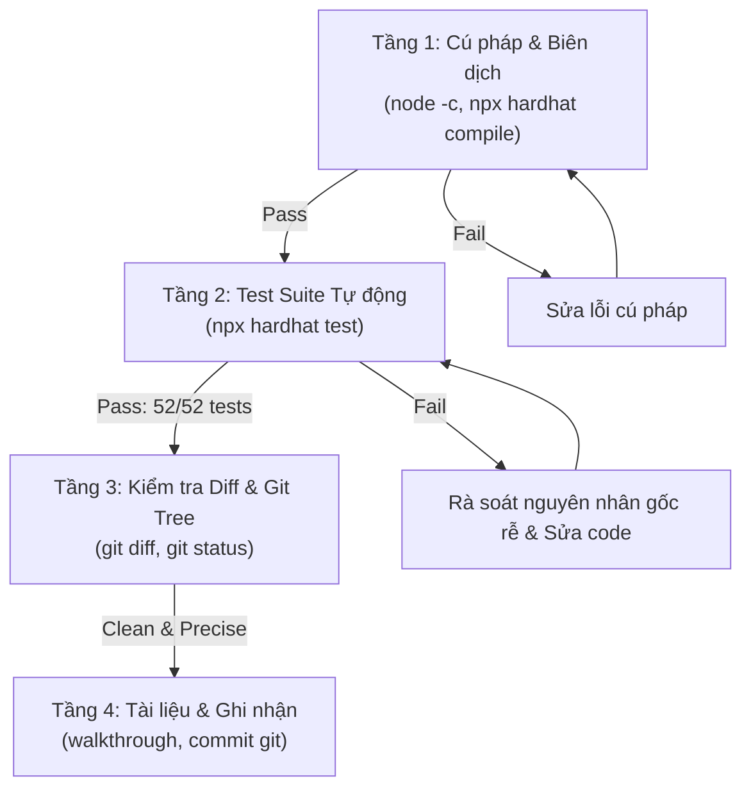

# Strict Verification Loop & Quality Gate

Cẩm nang quy trình kiểm chứng nghiêm ngặt, đóng vai trò là "Cổng chất lượng (Quality Gate)" ngăn ngừa lỗi hồi quy (regressions) và đảm bảo tính chuẩn xác trước khi bàn giao bất kỳ tính năng hoặc sửa lỗi nào.

---

## 1. Nguyên Tắc Cốt Lõi (Zero Tolerance Policy)

- **Không bao giờ tuyên bố hoàn thành mà chưa chạy lệnh kiểm chứng**: Mọi thay đổi mã nguồn (Solidity, JavaScript, HTML, CSS) đều phải trải qua các bước kiểm thử thực tế.
- **Không suy đoán (No Assumptions)**: Chỉ tin vào kết quả thực tế của terminal với exit code `0`.
- **Bảo toàn tính toàn vẹn (Integrity)**: Giữ nguyên vẹn toàn bộ chú thích, kiểu dữ liệu và cấu trúc tài liệu không liên quan đến phạm vi sửa đổi.

---

## 2. Quy Trình Kiểm Chứng 4 Tầng (4-Stage Quality Gate)

Mỗi khi thực hiện một thay đổi hoặc hoàn thành một tính năng, **BẮT BUỘC** thực thi tuần tự 4 tầng kiểm tra:



### Tầng 1: Kiểm Tra Cú Pháp & Biên Dịch (Syntax & Compilation Gate)
1. **Kiểm tra JavaScript**:
   ```powershell
   node -c demo/app.js
   ```
   *Yêu cầu:* Exit code `0`, không có lỗi cú pháp `SyntaxError`.
2. **Kiểm tra Hợp đồng Thông minh**:
   ```powershell
   npx hardhat compile
   ```
   *Yêu cầu:* Biên dịch thành công toàn bộ file `.sol` với zero warnings/errors.

### Tầng 2: Bộ Kiểm Thử Tự Động (Automated Test Suite Gate)
Thực thi toàn bộ bộ test suite trên EVM mô phỏng:
```powershell
npx hardhat test
```
*Yêu cầu nghiêm ngặt:*
- **Toàn bộ 52/52 test cases phải PASS 100%** (18 Unit Tests + 34 Layer 2 Hardhat Network Tests).
- Không có bất kỳ test case nào bị `skipped` hoặc `failed`.
- Nếu phát sinh lỗi, phải đọc log chi tiết, xác định nguyên nhân gốc rễ (root cause) và sửa dứt điểm trước khi báo cáo người dùng.

### Tầng 3: Rà Soát Thay Đổi Git (Diff & Integrity Review)
1. Kiểm tra trạng thái cây git:
   ```powershell
   git status
   ```
2. Rà soát từng dòng diff:
   ```powershell
   git diff
   ```
   *Mục tiêu kiểm tra:*
   - Không có file rác hoặc file tạm phát sinh ngoài ý muốn.
   - Không có code placeholder kiểu `// TODO: implement later` hoặc dòng code bỏ sót.
   - Các biến, hàm và thẻ HTML mới có được liên kết đầy đủ không bị orphan.

### Tầng 4: Cam Kết Mã Nguồn & Báo Cáo Nghiệm Thu
1. Tạo commit git theo chuẩn **Conventional Commits**:
   - `feat(...)`: Khi thêm tính năng mới.
   - `fix(...)`: Khi sửa lỗi.
   - `test(...)`: Khi bổ sung test cases.
   - `docs(...)`: Khi cập nhật tài liệu hoặc báo cáo nghiệm thu.
2. Cập nhật artifact nghiệm thu `walkthrough.md` với đầy đủ thông tin: Mã commit, kết quả test và bảng đối chiếu trước/sau.

---

## 3. Checklist Tự Động Cho Agent (Agent Self-Review Checklist)

Trước khi gửi câu trả lời hoàn tất cho người dùng, hãy tự trả lời 5 câu hỏi:
1. [ ] Bạn đã chạy `node -c` và `npx hardhat test` trong lượt này chưa?
2. [ ] Bộ test 52/52 có vượt qua 100% không?
3. [ ] Code có dòng nào bị placeholder hoặc chú thích `// ...existing code...` không?
4. [ ] Mọi đường dẫn file và symbol đã được tạo định dạng clickable link `[file.ext](file:///...)` chưa?
5. [ ] Đã lưu trữ commit git và cập nhật artifact liên quan chưa?
