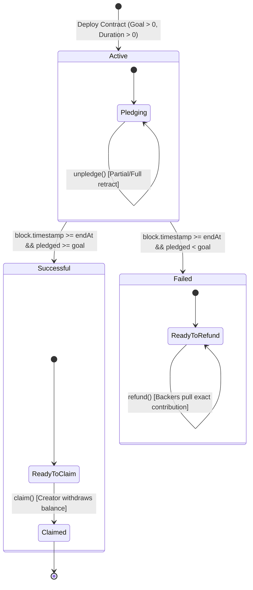

# BÁO CÁO ĐỒ ÁN MÔN HỌC: CÔNG NGHỆ BLOCKCHAIN
## ĐỀ TÀI: HỢP ĐỒNG THÔNG MINH HUY ĐỘNG VỐN CỘNG ĐỒNG (CROWDFUNDING) CÓ MỤC TIÊU VÀ HẠN THỜI GIAN
**Phân loại:** Nhóm C – Nâng cao (Điểm tối đa: 10.0) • **Đề:** W

> 📖 **QUYỂN BÁO CÁO MÔN HỌC CHI TIẾT THEO ĐỀ CƯƠNG 4 PHẦN:**
> * [**Trang bìa & Mục lục**](report/00_trang_bia_va_muc_luc.md)
> * [**Phần 1: Đặt vấn đề**](report/01_dat_van_de.md)
> * [**Phần 2: Cơ sở lý thuyết & Công nghệ**](report/02_co_so_ly_thuyet.md)
> * [**Phần 3: Phân tích, Thiết kế & Triển khai thực nghiệm**](report/03_trien_khai_va_thuc_nghiem.md)
> * [**Phần 4: Kết luận & Hướng phát triển**](report/04_ket_luan_va_huong_phat_trien.md)

---

## 1. PHÂN CÔNG CHUẨN BỊ VÀ TRÌNH BÀY BẢO VỆ (3 THÀNH VIÊN)

### 1.1. Phạm vi chuẩn bị theo ba luồng Blockchain

Mục tiêu là **ba người cùng bảo vệ một sản phẩm, mỗi người có một luận điểm Blockchain đủ sâu và có bằng chứng**, không phải chia ba module để phát triển độc lập. Giữ ba luồng **góp vốn và quyền rút trước hạn — điều kiện giải ngân thành công — hoàn tiền khi thất bại và chống hoàn sai**. Không có thành viên chỉ làm giao diện, slide hoặc chỉ chạy test cho người khác.

Tách hai loại phân công: **mục 1.1–1.2 là phạm vi chuẩn bị/rà soát tài liệu và bằng chứng**, còn **mục 1.3–1.4 là nội dung nói trong lượt chính**. Phạm vi chuẩn bị có thể rộng hơn thời lượng trình bày; không phải đọc hết danh sách hàm, công cụ hoặc thuật ngữ. Người trình bày chính hiểu sâu luồng của mình, không độc chiếm kiến thức; cả ba phải hiểu vòng đời chung ở mục 1.5. Không dùng số hàm, số slide, số test hoặc số dòng code để suy ra độ cân bằng hay tỷ lệ đóng góp.

> Đây là **phân công trách nhiệm từ thời điểm thống nhất**, không phải xác nhận ai đã viết mã nguồn có sẵn. Nhóm điền tên/MSSV tại [trang bìa](report/00_trang_bia_va_muc_luc.md), ghi nhận công việc thực tế bằng commit, test và nội dung báo cáo đã hoàn thành. Không tự gán tỷ lệ đóng góp khi chưa có đối chiếu của cả nhóm.

| Người chuẩn bị chính | Luận điểm và kiến thức cần hiểu sâu | Solidity cần đọc/đối chiếu | Kiểm thử và minh chứng cần chuẩn bị |
| :--- | :--- | :--- | :--- |
| **Thành viên 1 — Góp vốn và quyền rút trước hạn** | Nhận được ETH chưa đủ: phải ghi đúng quyền của từng backer và cập nhật nhất quán khi rút. Giải thích ETH/wei, `payable`, `msg.sender`, `msg.value`, mapping và tổng khoản góp; vì sao event không thay storage. | `pledge()`, `receive()`, `unpledge(uint256)`; `pledged`, `pledgedAmount`, `contributorCount`; event `Pledge`/`Unpledge`. | Nhiều ví góp, góp 0, chuyển ETH trực tiếp, rút một phần/toàn bộ, rút quá khoản góp, chặn góp/rút tại và sau hạn. Phụ trách cả test unpledge chuyển ETH lỗi: rollback khoản cá nhân/tổng/bộ đếm và retry. |
| **Thành viên 2 — Điều kiện giải ngân thành công** | Đủ vốn chưa đủ để giải ngân: phải hết hạn, đúng creator và chưa claim. Hiểu máy trạng thái, `block.timestamp`, goal/deadline và quyền gọi. Factory, `immutable`, custom error là phần chuẩn bị mở rộng, không bắt buộc nói trong lượt chính. | `constructor`, `state()`, `timeLeft()`, `progressBasisPoints()`, `onlyCreator`, `claim()`, cờ `claimed`; [CrowdfundingFactory.sol](../contracts/CrowdfundingFactory.sol). | Validation khởi tạo; đủ vốn nhưng chưa hết hạn; đúng giây `endAt`; đúng/sai người gọi; claim hai lần; vượt mục tiêu; factory. Phụ trách cả test claim chuyển ETH lỗi: rollback `claimed`, giữ quỹ và retry. |
| **Thành viên 3 — Hoàn tiền khi thất bại và chống hoàn sai** | Backer tự nhận lại đúng khoản, không hoàn hai lần và không mất quyền khi chuyển ETH lỗi. Dùng Pull-over-Push, CEI, guard và rollback để giải thích refund, không biến lượt chính thành tổng quan mọi vấn đề bảo mật. | `refund()`, `sweepExcessEther()`, modifier `nonReentrant` tự cài đặt; giải thích cơ chế chung và rà chéo CEI/guard với TV1/TV2; [hợp đồng kiểm thử an toàn](../contracts/testing/Attackers.sol). | Thất bại sau hạn; hoàn đúng khoản góp, không hoàn hai lần; chặn refund khi thành công; refund lỗi rollback/retry và cô lập lỗi giữa backer. Nested refund, forced ETH, sweep, fuzz và Slither là phần chuyên sâu; không nhận thay test lỗi unpledge/claim của TV1/TV2. |

**Mã nguồn và bộ test dùng chung:** [Crowdfunding.sol](../contracts/Crowdfunding.sol), [test EVM trên Hardhat](../test/Crowdfunding.evm.test.js) và [test mô hình JavaScript](../test/Crowdfunding.test.js). Mỗi người phụ trách các ca thuộc luồng của mình trong cả hai tầng khi có tương ứng; không coi mô hình JavaScript là thực thi Solidity. Các mục kiểm thử trên là phạm vi cần kiểm tra/chuẩn bị, không khẳng định mọi trường hợp đã có test riêng. Nếu thiếu, người phụ trách bổ sung hoặc ghi rõ khoảng trống.

### 1.2. Phân chia nội dung báo cáo

Giữ bố cục báo cáo 4 phần hiện có; chia nội dung **bên trong từng phần** theo luồng, không giao toàn bộ lý thuyết cho một người và toàn bộ thực nghiệm cho người khác.

| Thành viên | Nội dung biên soạn chính |
| :--- | :--- |
| **TV1** | [Phần 1](report/01_dat_van_de.md): bối cảnh, bài toán và yêu cầu góp/rút. [Phần 2](report/02_co_so_ly_thuyet.md): mục 2.1 về account/storage/gas và bổ sung giải thích `payable`, wei, mapping. [Phần 3](report/03_trien_khai_va_thuc_nghiem.md): mục 3.2.2 phần `pledge`/`receive`/`unpledge`; các test góp/rút ở 3.3 và demo tương ứng ở 3.4. |
| **TV2** | Phần 2: mục 2.2 về timestamp, `immutable`, custom error. Phần 3: mục 3.1 về trạng thái/phân quyền; mục 3.2.2 phần constructor/claim và các hàm đọc trạng thái; mục 3.2.3 factory; test vòng đời/factory ở 3.3, demo giải ngân ở 3.4. Rà lại mục tiêu/phạm vi 1.4 cùng TV1. |
| **TV3** | Phần 2: mục 2.3 về CEI/Pull-over-Push/reentrancy. Phần 3: mục 3.2.2 phần refund/sweep và guard; test an toàn/fuzz ở 3.3, phân tích kết quả Slither ở 3.3.1, demo thất bại/hoàn tiền ở 3.4. Chủ trì tổng hợp [Phần 4](report/04_ket_luan_va_huong_phat_trien.md), hai thành viên còn lại cung cấp kết quả và hạn chế của luồng mình. |

**Nội dung chung:** cả ba cùng viết/rà mục 2.4 (tương tác Web3) và 3.4 (thực nghiệm). TV1 giải thích gửi giá trị ETH/wei và rollback khi unpledge lỗi; TV2 giải thích signer, chain/contract, quyền creator và rollback khi claim lỗi; TV3 giải thích receipt, giao dịch lỗi, rollback khi refund/sweep lỗi và cơ chế an toàn chung. Mỗi người bổ sung hình/bảng hoặc log test của chính luồng mình; một người chỉ tổng hợp định dạng cuối cùng, không nhận thay phần chuyên môn của người khác.

**Đầu mối tích hợp Web3 — TV2:** tổng hợp kiểm tra toàn luồng trên cùng chain/campaign và ghi nhận môi trường, kết quả, phần chưa xác minh. TV1 kiểm tra nhập ETH/wei, góp/rút và ledger; TV2 kiểm tra kết nối, đổi account/chain, quyền creator và claim; TV3 kiểm tra refund, receipt và xử lý lỗi. Đầu mối không làm thay các thành viên và không được ghi nhận giao dịch mạng thật nếu chỉ chạy mock/sandbox.

**Tổng hợp Phần 4:** TV1 viết kết quả/hạn chế của góp/rút, TV2 viết vòng đời/claim/factory/Web3, TV3 viết refund và ghép các đoạn thành kết luận thống nhất. TV3 không phải tự viết thay kết quả và hướng phát triển của cả nhóm.

**Bảo mật và kiểm chứng là trách nhiệm chung:** mỗi người giải thích điều kiện lỗi, external call và rollback của luồng mình. TV3 làm đầu mối chuẩn bị minh chứng nested refund/forced ETH/sweep/fuzz/Slither, không phải người duy nhất chịu trách nhiệm tính an toàn của cả hệ thống. TV1 đối chiếu accounting góp/rút; TV2 đối chiếu trạng thái/claim; cả ba biết phạm vi và giới hạn của bằng chứng. Web3 là kiến thức chung; vai trò tích hợp của TV2 không có nghĩa phải dành riêng một phần nói dài về công nghệ kết nối.

### 1.3. Kịch bản trình bày và vấn đáp theo người

Gợi ý **3–4 phút/người**, điều chỉnh theo thời lượng giảng viên cho phép; đây là thời lượng chuẩn bị, không phải tỷ lệ đóng góp. Cân bằng bằng chất lượng lập luận, không phải mỗi người có đúng ba slide hoặc cùng số hàm.

| Người trình bày | Câu hỏi trung tâm | Kết luận phải chứng minh | Minh chứng chính |
| :--- | :--- | :--- | :--- |
| TV1 | Contract ghi nhận tiền và quyền backer như thế nào? | Cập nhật đúng khoản cá nhân và tổng khoản góp khi góp/rút; event không thay storage | Góp 3, rút 1, còn 2; rút quá khoản góp bị từ chối |
| TV2 | Khi nào và ai được nhận quỹ thành công? | Goal + deadline + quyền creator + chưa claim; đủ goal trước hạn vẫn Active | Trước hạn bị chặn; sau hạn ví thường sai quyền, creator claim được |
| TV3 | Làm sao hoàn đúng người, đúng khoản và không hoàn hai lần? | Refund theo caller; xóa khoản ghi nhận trước call, guard và revert bảo vệ luồng hoàn tiền | Refund đưa khoản cá nhân về 0; lần hai bị chặn; test chuyển ETH lỗi rollback |

Mỗi lượt theo cùng bốn bước: **quy tắc → quyết định thiết kế trong Solidity → kết quả đúng và trường hợp bị từ chối → bằng chứng trước/sau**. Chỉ chọn đoạn code ngắn phục vụ luận điểm, không đọc danh sách cú pháp. Chuẩn bị sẵn kết quả ba test tiêu biểu để đối chiếu; không bắt buộc chạy cả ba trực tiếp. Nêu đúng môi trường sandbox/EVM; ký ví và receipt chỉ giải thích đủ để nhận diện bằng chứng, không giảng lại stack Web3 ở từng lượt.

#### Thành viên 1: Tiền đi vào và quyền rút trước hạn

- **Trình tự demo:** reset mô phỏng → chọn Alice góp 3 ETH → rút 1 ETH → chỉ ra khoản góp còn 2 ETH và tổng ghi nhận giảm tương ứng → thử rút vượt khoản góp. Giải thích nhánh rút toàn bộ và cập nhật `contributorCount` bằng code/test. Sandbox không dùng gas thật; giao dịch EVM có phí gas riêng.
- **Luận điểm cần nói:** nhận ETH chưa đủ, contract phải lưu quyền rút của từng địa chỉ trong `pledgedAmount` và tổng khoản góp trong `pledged`. Khi rút 1 từ khoản 3, cả khoản cá nhân và tổng cùng giảm 1; rút toàn bộ còn ảnh hưởng bộ đếm. `msg.value`/wei là phương tiện giải thích thiết kế, không phải nội dung để đọc định nghĩa. Event là log, không thay mapping để kiểm tra quyền rút. Nếu chuyển ETH lỗi và revert, các thay đổi sổ sách cũng rollback; mở test chi tiết khi được hỏi. `receive()` và giới hạn forced ETH để phần hỏi sâu.
- **Câu hỏi tự luyện:** Vì sao `pledge()` là `payable`? Ai được rút khoản góp của Alice? Rút một phần khác rút toàn bộ thế nào? Đã đủ vốn nhưng chưa hết hạn thì còn góp/rút được không? Vì sao nút bị vô hiệu hóa trên web không thay thế kiểm tra trong contract?

#### Thành viên 2: Khi nào và ai được giải ngân?

- **Trình tự demo:** chọn kịch bản đủ 10/10 ETH ở ngày 6.9 → chọn creator, chỉ ra chưa được claim → chuyển đúng ngày 7.0 → chọn ví không phải creator, chỉ ra sai quyền → chọn creator và claim → đối chiếu `Claimed`, số dư quỹ về 0 nhưng `pledged`/mapping không bị xóa. Việc nút bị khóa là minh họa UI; dùng test EVM để chứng minh contract từ chối lời gọi không hợp lệ.
- **Luận điểm cần nói:** đủ vốn chưa đủ để giải ngân: trước hạn vẫn `Active`; tại `block.timestamp == endAt`, góp/rút trước hạn bị chặn và nhánh quyết toán mở. Claim còn kiểm tra đúng creator và chưa claim; hết hạn không tự gửi ETH. `claim()` lấy số dư thực tế, không chỉ `goal`; sau claim cờ `claimed` đổi nhưng accounting góp vẫn giữ nguyên. Factory và triển khai nhiều campaign để phần hỏi sâu, không chen vào mạch chính. Kiến thức provider/signer/receipt là nền chung, không bắt TV2 trình bày toàn bộ Web3.
- **Câu hỏi tự luyện:** Vì sao đủ vốn chưa đủ để claim? `state()` có phải biến storage được tự cập nhật không? Ai trả gas cho claim? Vì sao cần `claimed`? Nếu góp vượt goal thì tiền dư đi đâu? Các chiến dịch của factory chia sẻ tiền hay độc lập?

#### Thành viên 3: Thất bại thì hoàn đúng khoản và chống hoàn sai thế nào?

- **Trình tự demo:** chọn kịch bản thất bại sau hạn → chọn backer có góp → refund → chỉ ra khoản góp cá nhân về 0, tổng ghi nhận giảm và không thể hoàn lần hai. Dùng kết quả test EVM để đối chiếu refund lỗi rollback và backer khác vẫn rút được. Nested refund/forced ETH chuẩn bị cho phần hỏi sâu, không bắt buộc chạy trong lượt chính; không dùng animation sandbox làm bằng chứng chống tấn công.
- **Luận điểm cần nói:** người góp tự gọi refund và chỉ nhận khoản gắn với caller, không duyệt danh sách để đẩy tiền. Xóa khoản cá nhân và giảm tổng trước external call giúp chống hoàn sai; guard tự cài đặt chặn nested guarded calls. Nếu chuyển ETH lỗi và revert thì mapping/tổng cũng rollback, còn backer khác có thể refund trong giao dịch riêng. Giữ giải thích CEI/guard gắn với đoạn refund này, không mở thành bài tổng quan bảo mật. Phân tích forced ETH, bất biến toàn hệ thống, fuzz và Slither để phần hỏi sâu.
- **Câu hỏi tự luyện:** Tại sao không hoàn tiền bằng vòng lặp? CEI và `nonReentrant` khác nhau thế nào? `call` thất bại thì khoản ghi nhận có mất không? Sweep có lấy tiền thuộc khoản góp không? Sweep có bắt buộc hết hạn không? Test/fuzz/Slither chứng minh được và chưa chứng minh được điều gì?
- **Điểm phải nói đúng:** `sweepExcessEther()` chỉ cho creator rút `balance - pledged` khi dương, không yêu cầu hết hạn. Fuzz hiện tại kiểm tra các thao tác trong phạm vi kịch bản của test, không phải chứng minh hình thức cho mọi trạng thái. Passing tests hay chạy Slither không đồng nghĩa đã audit hoặc an toàn tuyệt đối.

### 1.4. Nội dung bắt buộc và phần hỏi sâu

Mỗi người chuẩn bị 3–4 phút cho phần cốt lõi; phần nâng cao dùng khi còn thời gian hoặc giảng viên hỏi. Không cố trình bày toàn bộ phạm vi phụ trách trong một lượt demo ngắn.

| Thành viên | Bắt buộc trình bày | Dự phòng khi hỏi sâu |
| :--- | :--- | :--- |
| TV1 | Vì sao cần mapping và tổng khoản góp; góp/rút cập nhật cả hai; quyền caller, ca rút bị từ chối và nguyên tắc rollback | receive, rút hết/góp lại, contributorCount và test unpledge lỗi rollback/retry chi tiết |
| TV2 | Đủ goal chưa đủ: deadline + đúng creator + chưa claim; state/balance/accounting trước-sau | Test claim lỗi rollback/retry; factory, phân trang, immutable, custom errors; chi tiết kết nối Web3 |
| TV3 | Refund đúng caller/khoản, không hoàn hai lần; CEI/guard trong refund, rollback và giao dịch backer riêng | Nested refund test chi tiết, forced ETH, sweep, fuzz và Slither; bằng chứng mở rộng chung của nhóm |

**Minh chứng cho mỗi người:** một bảng trước/sau và ba test EVM tiêu biểu. [Mục 3.3 của báo cáo](report/03_trien_khai_va_thuc_nghiem.md) có bảng đối chiếu và lệnh lọc test theo người. Đây là tiêu chí chuẩn bị, không tự xác nhận thành viên đã hoàn thành.

### 1.5. Kiến thức chung và điều kiện sẵn sàng bảo vệ

**Hai mức hiểu:** phần riêng phải giải thích sâu được code, test và tình huống lỗi; phần chung phải giải thích được nguyên lý của toàn bộ vòng đời tiền, không cần học thuộc mọi chi tiết công cụ nâng cao. Không trả lời câu hỏi nền tảng bằng “đó là phần của bạn khác”.

Cả ba phải giải thích được:

1. EOA/signer, địa chỉ contract, chain ID, ABI và RPC; đọc bằng `eth_call` khác giao dịch thay đổi state; ký giao dịch không có nghĩa đã được xác nhận.
2. Phí gas do người gửi giao dịch chi trả; giao dịch được đưa vào block rồi revert vẫn có thể tốn gas; cần xem receipt, trạng thái và event để đối chiếu.
3. Ba tầng minh chứng: **sandbox JavaScript** minh họa → **Hardhat EVM** chạy Solidity cục bộ → **giao dịch trên mạng đang kết nối** có hash/receipt. Không gọi sandbox là EVM hoặc coi chuyển slider là thay đổi timestamp của Sepolia.
4. Ranh giới nghiệp vụ: `unpledge` trước hạn; `claim` sau hạn khi đủ mục tiêu và đúng creator; `refund` sau hạn khi không đủ mục tiêu. Cả ba đọc toàn bộ contract để trả lời câu hỏi nối giữa các luồng.

**Công việc hỗ trợ dùng chung:** TV1 kiểm tra nhập số tiền và hiển thị ledger; TV2 kiểm tra điều kiện mục tiêu/thời hạn/phân quyền và kết nối đúng campaign; TV3 kiểm tra thông báo lỗi, receipt và luồng refund. UI/CSS, slide, CLI simulator và định dạng báo cáo được phối hợp theo năng lực, không thay thế phần Blockchain chính của bất kỳ ai. Khi sửa cùng file contract/test, nhóm thống nhất lượt hoặc tách commit nhỏ, tránh ba người sửa chồng cùng đoạn.

**Vòng rà chéo bắt buộc trước khi chốt báo cáo/demo:**

| Người rà | Phần cần rà | Câu hỏi đối chiếu chính |
| :--- | :--- | :--- |
| TV1 → TV2 | Vòng đời/claim | Goal và deadline có được xét đúng với sổ sách góp? Sau claim, balance và pledged được giải thích đúng không? |
| TV2 → TV3 | Refund/an toàn | Nhánh thành công/thất bại mở đúng quyền refund? Refund lỗi có rollback và giữ khả năng refund riêng của backer khác không? |
| TV3 → TV1 | Góp/rút | Mapping/tổng/bộ đếm có nhất quán? CEI/guard và rollback khi unpledge lỗi có được giải thích đúng không? |

Người rà ghi lại mục đã kiểm tra, nhận xét và kết quả xử lý; người phụ trách luồng vẫn chịu trách nhiệm sửa và giải thích phần của mình. Đây là kiểm tra chéo trong nhóm, không phải audit độc lập.

**Mỗi người chuẩn bị đủ 5 minh chứng:**

- [ ] Chỉ và giải thích được các hàm Solidity thuộc luồng mình, gồm điều kiện lỗi và thay đổi state.
- [ ] Chạy/giải thích được test thành công, test bị từ chối và ít nhất một biên quan trọng của luồng; ghi lại lệnh/kết quả thực tế, thiếu test thì bổ sung hoặc ghi rõ.
- [ ] Hoàn thiện nội dung báo cáo được phân công, có dẫn chứng code/test; rà chéo với một thành viên khác.
- [ ] Tự trình bày và thao tác được demo; phân biệt rõ minh họa UI với bằng chứng EVM/on-chain.
- [ ] Trả lời được các câu hỏi tự luyện và kiến thức chung; ghi nhận trung thực phần đã làm, phần cùng làm và phần còn thiếu.

Bảng này phân định trách nhiệm chuẩn bị và nghiệm thu; các ô chưa được nhóm xác nhận không được coi là đã hoàn thành.

### 1.6. Diễn tập để xác nhận khả năng bảo vệ

Mỗi người trình bày luồng mình **không đọc slide**, được mở đoạn code/test và bảng trước/sau để giải thích. Một người khác đổi đầu vào, thời điểm hoặc caller và yêu cầu dự đoán kết quả trước khi mở bằng chứng. Sau đó hỏi một câu nối luồng; không cần thêm tính năng hoặc chạy mọi test để diễn tập.

| Người trả lời | Câu hỏi nối luồng mẫu | Ý chính cần giải thích |
| :--- | :--- | :--- |
| TV1 | Rút trước hạn làm pledged xuống dưới goal; nếu hết hạn vẫn thiếu thì sao? | Chiến dịch Failed, creator không claim được; backer có khoản ghi nhận dương tự gọi refund |
| TV2 | Sau claim mapping vẫn còn, vì sao backer không refund được? | Điều kiện refund gồm đã hết hạn và pledged dưới goal; sau claim của nhánh thành công pledged vẫn đủ goal, không mở refund |
| TV3 | Trước deadline còn thiếu goal, vì sao không gọi refund ngay? | Refund bị CampaignActive; trước hạn dùng unpledge theo khoản của caller, không phải refund |

Chấm mức sẵn sàng bằng khả năng giải thích **quy tắc → code → dự đoán ca sai → bằng chứng**, không bằng số câu thuộc lòng. Nếu chưa trả lời được, ghi câu bị vướng và ôn lại cùng người phụ trách sâu; không chuyển toàn bộ câu hỏi khó sang TV3.

| Người | Đã tự trình bày và được hỏi chéo? | Điểm còn vướng / bằng chứng đã đối chiếu | Người nghe và kết quả luyện lại |
| :--- | :--- | :--- | :--- |
| TV1 | Chưa xác nhận | Nhóm điền sau diễn tập | Chưa xác nhận |
| TV2 | Chưa xác nhận | Nhóm điền sau diễn tập | Chưa xác nhận |
| TV3 | Chưa xác nhận | Nhóm điền sau diễn tập | Chưa xác nhận |

---

## 2. KIẾN TRÚC HỆ THỐNG VÀ SƠ ĐỒ THIẾT KẾ

### 2.1. Sơ đồ Máy trạng thái (State Machine Flow)

Hợp đồng kiểm soát chặt chẽ trạng thái quỹ và thời hạn (`block.timestamp` so với `endAt`):



### 2.2. Sơ đồ Tương tác Kiến trúc (Architecture Interaction)

```mermaid
sequenceDiagram
    autonumber
    actor Creator as 👑 Chủ dự án (Creator)
    actor Backer as 👤 Người đóng góp (Backer)
    participant Contract as 📄 Crowdfunding.sol
    participant Clock as ⏱ Blockchain Timestamp

    Note over Creator,Contract: Giai đoạn 1: Khởi tạo chiến dịch
    Creator->>Contract: deploy(goal: 10 ETH, duration: 7 Days)
    Contract-->>Creator: emit Launch(creator, goal, startAt, endAt)

    Note over Backer,Contract: Giai đoạn 2: Quyên góp vốn (Active)
    Backer->>Contract: pledge{value: 4 ETH}()
    Contract->>Contract: Update pledged & pledgedAmount[Backer]
    Contract-->>Backer: emit Pledge(Backer, 4 ETH, total)

    opt Rút cọc khi đang Active
        Backer->>Contract: unpledge(1 ETH)
        Contract->>Contract: CEI: Trừ pledgedAmount trước
        Contract->>Backer: Transfer 1 ETH
    end

    Note over Clock,Contract: Giai đoạn 3: Hết hạn thời gian (EndAt)
    Note over Clock,Contract: Khi xử lý call/transaction: so sánh timestamp của block với endAt; không có Clock gửi giao dịch tự động

    alt Trường hợp A: Đạt mục tiêu (pledged >= goal)
        Creator->>Contract: claim()
        Contract->>Contract: CEI: claimed = true; đọc balanceToClaim
        Contract-->>Creator: emit Claim(creator, balanceToClaim)
        Contract->>Creator: call chuyển balanceToClaim; revert nếu lỗi
        Backer-xContract: refund() -> Reverted: GoalAlreadyReached()
    else Trường hợp B: Không đạt mục tiêu (pledged < goal)
        Creator-xContract: claim() -> Reverted: GoalNotReached()
        Backer->>Contract: refund() [Pull Pattern]
        Contract->>Contract: CEI: pledgedAmount[Backer] = 0; pledged -= amount
        Contract-->>Backer: emit Refund(Backer, amount)
        Contract->>Backer: call chuyển amount; revert nếu lỗi
    end
```

---

## 3. PHÂN TÍCH AN NINH VÀ PHẠM VI KIỂM CHỨNG

Các cơ chế dưới đây giảm những rủi ro cụ thể, không chứng minh an toàn tuyệt đối. Phân biệt giải thích thiết kế với hành vi đã được test trên EVM.

### 3.1. CEI và bảo vệ tái nhập
* **CEI:** refund kiểm tra điều kiện, xóa `pledgedAmount[msg.sender]`, giảm `pledged`, emit event, sau đó mới call chuyển tiền. Nếu call lỗi, `TransferFailed` rollback sổ sách và event. Mẫu code đầy đủ ở [mục 2.3.1](report/02_co_so_ly_thuyet.md).
* **Guard tự cài đặt:** `_reentrancyStatus` chặn tái nhập các hàm có modifier trong cùng chuỗi lời gọi, không phải khóa đa luồng. Nested refund trong test bị chặn trước phần thân bởi `ReentrancyGuardTriggered`; không nhầm với `NothingToRefund` của checks sổ sách.
* **Bằng chứng động:** test kiểm tra selector lỗi nested refund và refund bên ngoài vẫn hoàn tất; receiver từ chối ETH kiểm tra rollback/retry ở unpledge, claim, refund và sweep. Không suy ra đã kiểm tra mọi callback hoặc mọi chuỗi trạng thái.

### 3.2. Pull-over-Push và sổ sách
* Vòng lặp push có thể bị một người nhận revert làm thất bại cả giao dịch hoặc vượt gas limit. Pull cho mỗi backer tự gọi refund; receiver từ chối ETH không làm backer khác mất khả năng gọi giao dịch riêng. Người gọi vẫn trả gas và cần ví có thể nhận ETH.
* Bất biến sổ sách là `pledged == Σ pledgedAmount`, không phải balance luôn bằng pledged. Sau claim balance có thể về 0 trong khi sổ sách còn; forced ETH có thể làm balance lớn hơn pledged.
* Sau EIP-6780, SELFDESTRUCT vẫn chuyển ETH kể cả từ contract cũ; điều kiện tạo và hủy cùng transaction liên quan đến xóa code/storage. Sweep chỉ lấy phần chênh dương theo điều kiện của hàm, chỉ creator và không bắt buộc hết hạn.

### 3.3. Custom errors và kết quả phân tích tĩnh
* Error không tham số như `GoalNotReached()` có revert data 4 bytes selector; error có tham số còn có dữ liệu ABI-encoded. Không đồng nhất kích thước revert data với toàn bộ bytecode của xử lý lỗi.
* Immutable/custom errors/guard placement có lý do tối ưu, nhưng chưa có benchmark để công bố mức gas tiết kiệm cố định.
* Slither 0.11.6 được chạy lại với solc 0.8.20: Crowdfunding có 13 instance, factory kèm dependency có 16, không có High/Medium ở hai lượt. Có 7 Low về timestamp ở mỗi lượt; các lượt bị trùng dependency nên không cộng tổng. [Báo cáo và raw JSON](security/slither-report.md) ghi rõ scope, source hash, severity và triage. Đây không phải audit độc lập.

---

## 4. HƯỚNG DẪN TRIỂN KHAI VÀ THỰC NGHIỆM

### 4.1. Chạy Thử nghiệm CLI & Kiểm thử Tự động
```bash
# 1. Di chuyển vào thư mục dự án
cd lab02-crowdfunding-smart-contract

# 2. Chạy bộ kiểm thử hai tầng (18 mô hình + 41 EVM = 59 test)
npm test
# hoặc: npm run test:mock  (18 test mô hình JavaScript)
#        npm run test:evm   (41 Hardhat EVM — bytecode thật)
# Hardhat discovery có thể in lại log mô hình; không đếm thêm 18 test.

# 3. Phân tích tĩnh (cần Slither và solc); lệnh scoped/raw output xem security/slither-report.md
npm run audit:static

# 4. Chạy kịch bản mô phỏng JavaScript, không thực thi bytecode
npm run simulate
# hoặc: node scripts/simulate.js
```

### 4.2. Khởi chạy Web DApp
```bash
# Mở trực tiếp bằng trình duyệt file: demo/index.html
# Hoặc khởi chạy local server:
npx serve demo
```

### 4.3. Triển khai lên Mạng Testnet Sepolia qua Remix IDE
1. Mở [Remix Ethereum IDE](https://remix.ethereum.org/).
2. Tạo file `Crowdfunding.sol` và dán mã nguồn từ thư mục `contracts/Crowdfunding.sol`.
3. Chọn Compiler `0.8.20`, optimizer bật với `200 runs` để tái lập cấu hình kiểm thử. Ghi lại EVM target/settings thực tế của Remix; không mặc định kết quả tương đương nếu đổi compiler/settings. Nhấn **Compile Crowdfunding.sol**.
4. Chuyển sang tab **Deploy & Run Transactions**:
   - Environment: Chọn **Injected Provider - MetaMask** (chọn mạng **Sepolia**).
   - Tham số khởi tạo `constructor`:
     - `_creator`: Địa chỉ ví của bạn (hoặc để `0x0000000000000000000000000000000000000000` để lấy `msg.sender`).
     - `_goal`: Số wei cần kêu gọi (ví dụ: `1000000000000000000` cho 1 ETH).
     - `_durationSeconds`: Thời gian hạn định (ví dụ: `604800` cho 7 ngày, hoặc `600` cho 10 phút demo).
   - Nhấn **Deploy** và xác nhận trên MetaMask.
5. Sao chép địa chỉ hợp đồng vừa triển khai dán vào Web DApp tại ô **MetaMask Web3 Connector** để điều khiển trực tiếp trên web!

---

## 5. MƯỜI CÂU HỎI TỰ LUYỆN VẤN ĐÁP

Các câu hỏi dưới giúp luyện giải thích code và giới hạn của hệ thống; không thay thế hiểu toàn bộ contract hoặc bảo đảm kết quả chấm điểm.

#### Câu 1: Tại sao nhóm lại sử dụng `call{value: amount}("")` thay vì `transfer()` hoặc `send()`?
> **Trả lời:**
> Stipend 2.300 gas của transfer/send có thể không đủ cho logic nhận ETH của một số contract; không dùng stipend làm bằng chứng chống tái nhập. Call linh hoạt hơn nhưng vẫn chịu quy tắc chuyển tiếp gas của EVM/EIP-150 và người nhận có thể revert. Contract dùng CEI, guard tự cài đặt, kiểm tra success và rollback nếu chuyển lỗi. Test chứng minh một số trường hợp tương thích/thất bại, không bảo đảm hỗ trợ mọi ví.

#### Câu 2: Biến thời gian `block.timestamp` có thể bị thợ đào (miner/validator) thao túng không?
> **Trả lời:**
> Trên Ethereum PoS, timestamp của execution payload phải khớp thời điểm tính cho slot, không có quyền tùy chọn lệch ±12–15 giây cho cùng slot. Tuy nhiên slot có thể bị bỏ qua, giao dịch có thể đến muộn hoặc không được đưa vào block trước hạn. Contract so sánh timestamp của block thực thi, không phải lúc người dùng nhấn gửi. Duration thực tế cho phép 1 giây đến 365 ngày; 7 ngày chỉ là ví dụ. Không dùng timestamp làm nguồn ngẫu nhiên an toàn. Xem [đặc tả đồng thuận](https://github.com/ethereum/consensus-specs/blob/master/specs/bellatrix/beacon-chain.md#process_execution_payload).

#### Câu 3: Giải thích chi tiết tại sao Push Refund lại nguy hiểm và Pull Refund giải quyết vấn đề đó thế nào?
> **Trả lời:**
> - Với vòng lặp push xử lý tất cả người nhận trong cùng giao dịch và revert khi chuyển lỗi, một receiver revert có thể làm toàn bộ giao dịch thất bại; vòng lặp lớn còn có nguy cơ vượt gas limit.
> - Pull tách thành giao dịch riêng của từng backer. Test dùng receiver từ chối ETH xác nhận backer khác vẫn refund được. Receiver lỗi vẫn có thể không nhận được khoản của họ; không suy ra mọi rủi ro giữa tài khoản đã được loại bỏ. Refund cũng không tự chạy hoặc hoàn phí gas.

#### Câu 4: Trong hàm `refund()`, nếu lệnh gửi tiền `call` thất bại thì điều gì xảy ra?
> **Trả lời:**
> Ta có lệnh kiểm tra `if (!success) revert TransferFailed();`. Trong EVM, khi lệnh `revert` được kích hoạt, toàn bộ thay đổi trạng thái trước đó (bao gồm cả việc gán `pledgedAmount[msg.sender] = 0`) đều được hoàn tác (rollback) về trạng thái ban đầu, và người dùng không bị mất số dư ghi nhận trong hợp đồng.

#### Câu 5: Tại sao hàm `claim()` lại yêu cầu cả hai điều kiện: `block.timestamp >= endAt` VÀ `pledged >= goal`?
> **Trả lời:**
> Để bảo vệ quyền lợi của người ủng hộ. Dù dự án đã đạt mục tiêu sớm trước 3 ngày, chủ dự án vẫn không được rút tiền sớm nhằm đảm bảo trong thời gian chiến dịch còn hoạt động, người ủng hộ vẫn có quyền cân nhắc rút lại tiền (`unpledge()`) nếu phát hiện chủ dự án có dấu hiệu bất thường. Tiền chỉ được giải ngân sau khi hết hạn chiến dịch.

#### Câu 6: Custom Errors trong Solidity 0.8.20 tiết kiệm gas như thế nào so với `require` chuỗi dài?
> **Trả lời:**
> Custom error không tham số như GoalNotReached() trả revert data gồm 4 bytes selector. Nếu có tham số thì còn dữ liệu ABI-encoded của chúng. So với chuỗi lỗi dài, có thể giảm bytecode và chi phí mã hóa dữ liệu lỗi; không phải lưu chuỗi lỗi vào storage bằng SSTORE. Mức cải thiện phụ thuộc compiler, optimizer và đường thực thi. Nhóm chưa có benchmark đối chứng nên không nêu số gas tiết kiệm cố định.

#### Câu 7: Có trường hợp nào số dư thực tế của hợp đồng (`address(this).balance`) lớn hơn biến `pledged` không?
> **Trả lời:**
> Có, ví dụ SELFDESTRUCT chuyển ETH mà không chạy receive và không tăng pledged. EIP-6780 vẫn cho chuyển balance từ contract cũ; ngoại lệ cùng transaction liên quan đến việc xóa code/storage. Claim chuyển toàn bộ balance tại thời điểm claim; khi thiếu goal, creator chỉ có thể sweep phần dư dương theo điều kiện hàm. Chiều ngược lại cũng có thể xảy ra: sau claim, balance bằng 0 trong khi pledged/mapping vẫn còn. Vì vậy không coi balance == pledged là bất biến toàn vòng đời.

#### Câu 8: `immutable` khác `constant` như thế nào trong hợp đồng này?
> **Trả lời:**
> - `constant` phải được gán giá trị cố định ngay tại thời điểm biên dịch mã nguồn (compile-time).
> - `immutable` cho phép gán giá trị một lần duy nhất trong `constructor` lúc triển khai hợp đồng (runtime), và sau đó được ghi trực tiếp vào bytecode thay vì tốn slot lưu trữ trên `storage` (SSTORE/SLOAD). Nhóm dùng `immutable` cho `creator`, `goal`, `startAt`, `endAt` để tránh đọc các giá trị này từ storage; mức cải thiện cần benchmark đối chứng, không khẳng định tối ưu tuyệt đối.

#### Câu 9: Vai trò của `CrowdfundingFactory.sol` là gì?
> **Trả lời:**
> Factory Pattern bổ sung khả năng tạo và tra cứu nhiều campaign độc lập; không đồng nghĩa đã có một launchpad production hoàn chỉnh. Bất kỳ ai cũng có thể gọi `createCampaign()` để triển khai một hợp đồng Crowdfunding độc lập, có thể tra cứu danh sách chiến dịch theo người tạo hoặc phân trang danh sách cho giao diện Web3.

#### Câu 10: Quy trình ký giao dịch và gửi lên mạng từ Web DApp diễn ra như thế nào?
> **Trả lời:**
> DApp dùng BrowserProvider, yêu cầu quyền tài khoản, kiểm tra chain ID/địa chỉ đích và tạo signer. Khi pledge, yêu cầu giao dịch có to, calldata của pledge() và value tính bằng wei; số tiền được parse từ chuỗi bằng ethers.parseEther. Với tài khoản khóa secp256k1 trong ví dùng ở demo, MetaMask yêu cầu xác nhận và ký cục bộ, không gửi khóa riêng cho DApp, rồi gửi giao dịch qua provider. Có hash chưa đồng nghĩa thành công: cần receipt, kiểm tra kết quả và đọc state. Giao dịch được đưa vào block rồi revert vẫn có thể tốn gas; kết quả provider giả lập không chứng minh đã có chữ ký/broadcast MetaMask thật.

---

## 6. KẾT LUẬN VÀ ĐÁNH GIÁ

* Đề tài triển khai các luồng góp vốn, rút trước hạn, giải ngân và hoàn tiền; mỗi thành viên có phần Solidity, test và báo cáo để giải thích.
* Lần chạy npm test ngày 2026-11-11 đạt 18 test mô hình và 41 test EVM; test cap factory dùng 101 campaign. Hai lượt Slither production không báo High/Medium, có Low/Informational được ghi trong raw JSON. Kết quả không xác nhận coverage 100%, audit độc lập hay an toàn tuyệt đối.
* Sandbox là minh họa JavaScript, CLI là mô hình, Hardhat là EVM cục bộ. [Phụ lục](report/06_doi_chieu_va_minh_chung.md) ghi receipt/state trước-sau từ script RPC local; không lấy chúng hoặc provider giả lập làm bằng chứng MetaMask ký/Sepolia.
* Chuẩn bị trình bày bằng [nội dung 9 slide](defense-slides.md), [hướng dẫn local](local-demo.md) và [tài liệu tham khảo](report/05_tai_lieu_tham_khao.md). Nhóm còn cần điền thông tin bìa, xác nhận ví thủ công và xuất bản nộp theo rubric thực tế.
