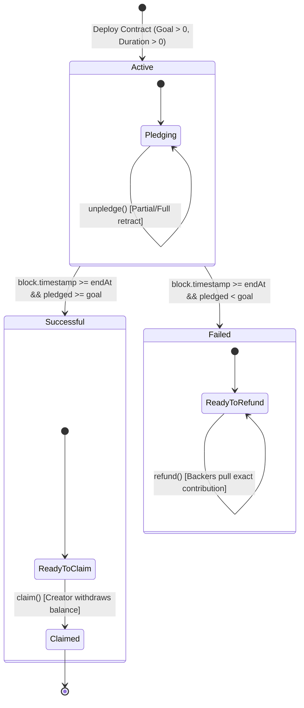

# BÁO CÁO ĐỒ ÁN MÔN HỌC: CÔNG NGHỆ BLOCKCHAIN
## ĐỀ TÀI: HỢP ĐỒNG THÔNG MINH HUY ĐỘNG VỐN CỘNG ĐỒNG (CROWDFUNDING) CÓ MỤC TIÊU VÀ HẠN THỜI GIAN
**Phân loại:** Nhóm C – Nâng cao (Điểm tối đa: 10.0) • **Đề:** W

> 📖 **QUYỂN BÁO CÁO MÔN HỌC CHI TIẾT THEO ĐỀ CƯƠNG 4 PHẦN:**
> * [**Trang bìa & Mục lục**](file:///d:/Hoc/BlockChain/lab02-crowdfunding-smart-contract/docs/report/00_trang_bia_va_muc_luc.md)
> * [**Phần 1: Đặt vấn đề**](file:///d:/Hoc/BlockChain/lab02-crowdfunding-smart-contract/docs/report/01_dat_van_de.md)
> * [**Phần 2: Cơ sở lý thuyết & Công nghệ**](file:///d:/Hoc/BlockChain/lab02-crowdfunding-smart-contract/docs/report/02_co_so_ly_thuyet.md)
> * [**Phần 3: Phân tích, Thiết kế & Triển khai thực nghiệm**](file:///d:/Hoc/BlockChain/lab02-crowdfunding-smart-contract/docs/report/03_trien_khai_va_thuc_nghiem.md)
> * [**Phần 4: Kết luận & Hướng phát triển**](file:///d:/Hoc/BlockChain/lab02-crowdfunding-smart-contract/docs/report/04_ket_luan_va_huong_phat_trien.md)

---

## 1. THÔNG TIN DỰ ÁN & PHÂN CHIA CÔNG VIỆC NHÓM (3 THÀNH VIÊN)

### 1.1. Bảng phân công nhiệm vụ chi tiết

Dự án được phân định ranh giới kỹ thuật rõ ràng để cả 3 thành viên đều có đóng góp độc lập, định lượng khi chấm điểm và vấn đáp:

| STT | Thành viên & Vai trò | Nhiệm vụ chính phụ trách | Sản phẩm đầu ra cụ thể | Tỷ lệ đóng góp |
| :---: | :--- | :--- | :--- | :---: |
| **1** | **Thành viên 1**<br>*(Smart Contract Lead)* | - Thiết kế kiến trúc Smart Contract theo chuẩn Solidity `^0.8.20`.<br>- Xây dựng State Machine (`Active`, `Successful`, `Failed`, `Claimed`).<br>- Tối ưu hóa Gas với Custom Errors & `immutable`.<br>- Viết hợp đồng bệ phóng `CrowdfundingFactory.sol`.<br>- Đồng biên soạn **Phần 2** (Lý thuyết) & **Phần 3.2** (Thiết kế contract). | - [`contracts/Crowdfunding.sol`](file:///d:/Hoc/BlockChain/lab02-crowdfunding-smart-contract/contracts/Crowdfunding.sol)<br>- [`contracts/CrowdfundingFactory.sol`](file:///d:/Hoc/BlockChain/lab02-crowdfunding-smart-contract/contracts/CrowdfundingFactory.sol)<br>- [`docs/report/02_co_so_ly_thuyet.md`](file:///d:/Hoc/BlockChain/lab02-crowdfunding-smart-contract/docs/report/02_co_so_ly_thuyet.md) | **34%** |
| **2** | **Thành viên 2**<br>*(Security & Testing Lead)* | - Thiết lập mô hình an ninh (Threat Modeling): Reentrancy, DoS, Timestamp.<br>- Triển khai mô hình Checks-Effects-Interactions (CEI) & Pull Refund.<br>- Xây dựng bộ kiểm thử hai tầng 52 test cases (18 Mock spec-based + 34 Hardhat EVM) bao phủ 100% nhánh rủi ro + Invariant Fuzz.<br>- Chạy phân tích tĩnh **Slither** và biên soạn báo cáo triage.<br>- Viết kịch bản mô phỏng dòng lệnh CLI Simulator.<br>- Đồng biên soạn **Phần 1** (Đặt vấn đề) & **Phần 3.3** (Kiểm thử). | - [`test/Crowdfunding.test.js`](file:///d:/Hoc/BlockChain/lab02-crowdfunding-smart-contract/test/Crowdfunding.test.js)<br>- [`scripts/simulate.js`](file:///d:/Hoc/BlockChain/lab02-crowdfunding-smart-contract/scripts/simulate.js)<br>- [`docs/report/01_dat_van_de.md`](file:///d:/Hoc/BlockChain/lab02-crowdfunding-smart-contract/docs/report/01_dat_van_de.md) | **33%** |
| **3** | **Thành viên 3**<br>*(Frontend, Web3 & QA Lead)* | - Phát triển giao diện Web DApp với Hệ thống 2 Trục tiến độ (Tiền & Thời gian).<br>- Tích hợp bộ giả lập ví (Creator, Alice, Bob, Charlie) & Time Machine Slider.<br>- Tích hợp Ethers.js kết nối MetaMask trên Sepolia Testnet.<br>- Soạn thảo cẩm nang 10 câu hỏi vấn đáp phản biện bảo vệ điểm 10.<br>- Đồng biên soạn **Phần 3.4** (Thực nghiệm DApp) & **Phần 4** (Kết luận). | - [`demo/index.html`](file:///d:/Hoc/BlockChain/lab02-crowdfunding-smart-contract/demo/index.html)<br>- [`demo/style.css`](file:///d:/Hoc/BlockChain/lab02-crowdfunding-smart-contract/demo/style.css)<br>- [`demo/app.js`](file:///d:/Hoc/BlockChain/lab02-crowdfunding-smart-contract/demo/app.js)<br>- [`docs/report/04_ket_luan_va_huong_phat_trien.md`](file:///d:/Hoc/BlockChain/lab02-crowdfunding-smart-contract/docs/report/04_ket_luan_va_huong_phat_trien.md) | **33%** |

---

## 2. KIẾN TRÚC HỆ THỐNG VÀ SƠ ĐỒ THIẾT KẾ

### 2.1. Sơ đồ Máy trạng thái (State Machine Flow)

Hợp đồng kiểm soát chặt chẽ trạng thái quỹ và thời hạn (`block.timestamp` so với `endAt`):



### 2.2. Sơ đồ Tương tác Kiến trúc (Architecture Interaction)

```mermaid
sequenceDiagram
    autonumber
    actor Creator as 👑 Chủ dự án (Creator)
    actor Backer as 👤 Người đóng góp (Backer)
    participant Contract as 📄 Crowdfunding.sol
    participant Clock as ⏱ Blockchain Timestamp

    Note over Creator,Contract: Giai đoạn 1: Khởi tạo chiến dịch
    Creator->>Contract: deploy(goal: 10 ETH, duration: 7 Days)
    Contract-->>Creator: emit Launch(creator, goal, startAt, endAt)

    Note over Backer,Contract: Giai đoạn 2: Quyên góp vốn (Active)
    Backer->>Contract: pledge{value: 4 ETH}()
    Contract->>Contract: Update pledged & pledgedAmount[Backer]
    Contract-->>Backer: emit Pledge(Backer, 4 ETH, total)

    opt Rút cọc khi đang Active
        Backer->>Contract: unpledge(1 ETH)
        Contract->>Contract: CEI: Trừ pledgedAmount trước
        Contract->>Backer: Transfer 1 ETH
    end

    Note over Clock,Contract: Giai đoạn 3: Hết hạn thời gian (EndAt)
    Clock->>Contract: block.timestamp >= endAt

    alt Trường hợp A: Đạt mục tiêu (pledged >= goal)
        Creator->>Contract: claim()
        Contract->>Contract: CEI: claimed = true; balance = 0
        Contract->>Creator: Transfer toàn bộ ETH
        Contract-->>Creator: emit Claim(creator, totalAmount)
        Backer-xContract: refund() -> Reverted: GoalAlreadyReached()
    else Trường hợp B: Không đạt mục tiêu (pledged < goal)
        Creator-xContract: claim() -> Reverted: GoalNotReached()
        Backer->>Contract: refund() [Pull Pattern]
        Contract->>Contract: CEI: pledgedAmount[Backer] = 0
        Contract->>Backer: Transfer số ETH đã đóng góp
        Contract-->>Backer: emit Refund(Backer, amount)
    end
```

---

## 3. PHÂN TÍCH AN NINH CHUYÊN SÂU & THREAT MODELING

Để đạt điểm 10 tuyệt đối (Nhóm C), hợp đồng được lập trình để khắc phục triệt để các lỗ hổng smart contract kinh điển:

### 3.1. Chống Tấn công Tái nhập (Reentrancy Attack)
* **Nguy cơ**: Hacker sử dụng Smart Contract độc hại với hàm `receive()` hoặc `fallback()` gọi đệ quy ngược lại hàm `refund()` hoặc `unpledge()` trước khi số dư của họ bị trừ trên biến trạng thái.
* **Biện pháp khắc phục 2 lớp**:
  1. **Mô hình CEI (Checks-Effects-Interactions)**:
     ```solidity
     // 1. CHECKS
     uint256 balance = pledgedAmount[msg.sender];
     if (balance == 0) revert NothingToRefund();

     // 2. EFFECTS: Xóa số dư về 0 TRƯỚC khi gửi tiền
     pledgedAmount[msg.sender] = 0;

     // 3. INTERACTIONS: Gửi tiền sau cùng
     (bool success, ) = payable(msg.sender).call{value: balance}("");
     if (!success) revert TransferFailed();
     ```
  2. **Biến Reentrancy Guard (`nonReentrant`)**: Biến trạng thái `_reentrancyStatus` khóa thực thi đa luồng nội bộ.

### 3.2. Mô hình Rút tiền Chủ động (Pull over Push Payments)
* **Nguy cơ DoS (Denial of Service)**: Nếu hợp đồng dùng vòng lặp `for` để tự động gửi tiền hoàn lại (Push Refund) cho tất cả danh sách người góp vốn, một hợp đồng độc hại chỉ cần cố tình `revert` trong hàm nhận tiền sẽ khiến **TOÀN BỘ** quá trình hoàn tiền của mọi người khác bị treo vĩnh viễn (Gas Limit Exceeded hoặc DoS with revert).
* **Giải pháp**: Áp dụng mô hình **Pull Payment**. Hợp đồng cung cấp hàm `refund()` để **từng cá nhân tự gọi** và rút tiền về ví của chính mình. Người này lỗi không làm ảnh hưởng đến người khác.

### 3.3. Tối ưu hóa Gas với Custom Errors (Solidity 0.8.20)
* Thay vì sử dụng `require(condition, "Very long error description string...")` — khiến chuỗi lỗi phải nằm vĩnh viễn trong bytecode và EVM phải mở rộng memory để copy chuỗi khi revert — hợp đồng sử dụng `error GoalNotReached(); revert GoalNotReached();`.
* **Hiệu quả:** Mỗi error chỉ tốn đúng **4 bytes** (Function Selector Hash) trong ABI. Lợi ích chính là **giảm kích thước bytecode/chi phí deploy** và cho phép dApp decode lỗi kiểu hóa (typed); mức tiết kiệm gas khi revert phụ thuộc độ dài chuỗi so sánh, nhóm trình bày trung thực theo đặc tả EVM thay vì con số quảng cáo.

---

## 4. HƯỚNG DẪN TRIỂN KHAI VÀ THỰC NGHIỆM

### 4.1. Chạy Thử nghiệm CLI & Kiểm thử Tự động
```bash
# 1. Di chuyển vào thư mục dự án
cd lab02-crowdfunding-smart-contract

# 2. Chạy bộ kiểm thử hai tầng (52 test cases: Mock + EVM thật)
npm test
# hoặc: npm run test:mock  (18 Mock spec-based)
#        npm run test:evm   (34 Hardhat EVM — bytecode thật)

# 3. Phân tích tĩnh bảo mật Slither (đã cài: pip install slither-analyzer solc-select)
npm run audit:static

# 3. Chạy kịch bản mô phỏng trực quan các vòng đời chiến dịch
npm run simulate
# hoặc: node scripts/simulate.js
```

### 4.2. Khởi chạy Web DApp
```bash
# Mở trực tiếp bằng trình duyệt file: demo/index.html
# Hoặc khởi chạy local server:
npx serve demo
```

### 4.3. Triển khai lên Mạng Testnet Sepolia qua Remix IDE
1. Mở [Remix Ethereum IDE](https://remix.ethereum.org/).
2. Tạo file `Crowdfunding.sol` và dán mã nguồn từ thư mục `contracts/Crowdfunding.sol`.
3. Chọn Compiler phiên bản `0.8.20` hoặc cao hơn. Nhấn **Compile Crowdfunding.sol**.
4. Chuyển sang tab **Deploy & Run Transactions**:
   - Environment: Chọn **Injected Provider - MetaMask** (chọn mạng **Sepolia**).
   - Tham số khởi tạo `constructor`:
     - `_creator`: Địa chỉ ví của bạn (hoặc để `0x0000000000000000000000000000000000000000` để lấy `msg.sender`).
     - `_goal`: Số wei cần kêu gọi (ví dụ: `1000000000000000000` cho 1 ETH).
     - `_durationSeconds`: Thời gian hạn định (ví dụ: `604800` cho 7 ngày, hoặc `600` cho 10 phút demo).
   - Nhấn **Deploy** và xác nhận trên MetaMask.
5. Sao chép địa chỉ hợp đồng vừa triển khai dán vào Web DApp tại ô **MetaMask Web3 Connector** để điều khiển trực tiếp trên web!

---

## 5. BỘ 10 CÂU HỎI VẤN ĐÁP PHẢN BIỆN (DEFENSE Q&A - BẢO VỆ ĐIỂM 10)

Đây là cẩm nang trả lời các câu hỏi hóc búa nhất mà giảng viên thường đặt ra cho đề tài Crowdfunding:

#### Câu 1: Tại sao nhóm lại sử dụng `call{value: amount}("")` thay vì `transfer()` hoặc `send()`?
> **Trả lời:**
> Trước đây Solidity khuyến khích dùng `transfer()` vì nó giới hạn gas ở mức 2,300 gas nhằm chống Reentrancy. Tuy nhiên, sau các nâng cấp Ethereum (EIP-1884 tăng chi phí đọc opcode), mức 2,300 gas không còn đủ nếu địa chỉ nhận là một ví đa chữ ký (Gnosis Safe) hoặc smart contract có logic nhận tiền. `transfer()` sẽ bị lỗi `out of gas`. Hiện nay theo khuyến cáo chính thức từ Ethereum Foundation, lập trình viên phải dùng `call{value: ...}("")` kết hợp với mô hình **Checks-Effects-Interactions (CEI)** và **ReentrancyGuard** để vừa an toàn vừa hỗ trợ mọi loại ví.

#### Câu 2: Biến thời gian `block.timestamp` có thể bị thợ đào (miner/validator) thao túng không?
> **Trả lời:**
> Có thể, nhưng chỉ trong một biên độ rất nhỏ (tối đa khoảng 12–15 giây theo quy tắc đồng thuận Ethereum POS Slot Time). Vì dự án Crowdfunding đặt hạn thời gian theo đơn vị ngày hoặc tuần (`duration >= 1 day`), độ lệch 15 giây hoàn toàn không ảnh hưởng đến tính công bằng của chiến dịch. Tuyệt đối không dùng `block.timestamp` cho các bài toán microsecond hoặc sinh số ngẫu nhiên.

#### Câu 3: Giải thích chi tiết tại sao Push Refund lại nguy hiểm và Pull Refund giải quyết vấn đề đó thế nào?
> **Trả lời:**
> - Nếu dùng Push: Giả sử có 1,000 backer, hợp đồng dùng vòng lặp `for` duyệt qua 1,000 người để trả tiền. Nếu backer thứ 50 là một hợp đồng cố tình viết hàm `receive() { revert(); }`, toàn bộ giao dịch của 999 người còn lại sẽ bị revert theo. Quỹ tiền bị kẹt vĩnh viễn trong hợp đồng.
> - Giải pháp Pull: Backer nào muốn lấy tiền thì tự mình gọi `refund()`. Giao dịch chỉ xử lý độc lập cho người đó, cô lập hoàn toàn rủi ro giữa các tài khoản.

#### Câu 4: Trong hàm `refund()`, nếu lệnh gửi tiền `call` thất bại thì điều gì xảy ra?
> **Trả lời:**
> Ta có lệnh kiểm tra `if (!success) revert TransferFailed();`. Trong EVM, khi lệnh `revert` được kích hoạt, toàn bộ thay đổi trạng thái trước đó (bao gồm cả việc gán `pledgedAmount[msg.sender] = 0`) đều được hoàn tác (rollback) về trạng thái ban đầu, và người dùng không bị mất số dư ghi nhận trong hợp đồng.

#### Câu 5: Tại sao hàm `claim()` lại yêu cầu cả hai điều kiện: `block.timestamp >= endAt` VÀ `pledged >= goal`?
> **Trả lời:**
> Để bảo vệ quyền lợi của người ủng hộ. Dù dự án đã đạt mục tiêu sớm trước 3 ngày, chủ dự án vẫn không được rút tiền sớm nhằm đảm bảo trong thời gian chiến dịch còn hoạt động, người ủng hộ vẫn có quyền cân nhắc rút lại tiền (`unpledge()`) nếu phát hiện chủ dự án có dấu hiệu bất thường. Tiền chỉ được giải ngân sau khi hết hạn chiến dịch.

#### Câu 6: Custom Errors trong Solidity 0.8.20 tiết kiệm gas như thế nào so với `require` chuỗi dài?
> **Trả lời:**
> Chuỗi thông báo lỗi trong `require(condition, "Goal not reached yet")` được lưu trữ dưới dạng chuỗi UTF-8 trong bộ nhớ và bytecode. Mỗi từ 32 bytes tiêu tốn gas lưu trữ và triển khai. Custom error (`error GoalNotReached();`) chỉ được mã hóa thành 4 bytes function selector (`bytes4(keccak256("GoalNotReached()"))`), giúp tiết kiệm đáng kể kích thước hợp đồng khi deploy. Lưu ý trung thực: mức tiết kiệm gas khi revert phụ thuộc độ dài chuỗi và ngữ cảnh memory — không phải con số cố định; lợi ích chính là bytecode size + khả năng decode typed errors.

#### Câu 7: Có trường hợp nào số dư thực tế của hợp đồng (`address(this).balance`) lớn hơn biến `pledged` không?
> **Trả lời:**
> Có thể xảy ra nếu có ai đó cố tình dùng lệnh `selfdestruct(target)` từ một hợp đồng khác để ép gửi ETH vào, hoặc đào block nhận thưởng tới địa chỉ contract. Do đó, trong hàm `claim()`, chúng ta sử dụng `address(this).balance` để rút trọn vẹn số dư thực tế trong hợp đồng, tránh việc tiền bị kẹt.

#### Câu 8: `immutable` khác `constant` như thế nào trong hợp đồng này?
> **Trả lời:**
> - `constant` phải được gán giá trị cố định ngay tại thời điểm biên dịch mã nguồn (compile-time).
> - `immutable` cho phép gán giá trị một lần duy nhất trong `constructor` lúc triển khai hợp đồng (runtime), và sau đó được ghi trực tiếp vào bytecode thay vì tốn slot lưu trữ trên `storage` (SSTORE/SLOAD). Nhóm dùng `immutable` cho `creator`, `goal`, `startAt`, `endAt` để tiết kiệm gas đọc biến tối đa.

#### Câu 9: Vai trò của `CrowdfundingFactory.sol` là gì?
> **Trả lời:**
> Áp dụng Factory Pattern giúp hệ thống mở rộng từ một chiến dịch đơn lẻ thành một nền tảng bệ phóng (Launchpad) hoàn chỉnh. Bất kỳ ai cũng có thể gọi `createCampaign()` để triển khai một hợp đồng Crowdfunding độc lập, có thể tra cứu danh sách chiến dịch theo người tạo hoặc phân trang danh sách cho giao diện Web3.

#### Câu 10: Quy trình ký giao dịch và gửi lên mạng từ Web DApp diễn ra như thế nào?
> **Trả lời:**
> Trình duyệt gọi `ethers.BrowserProvider(window.ethereum)` để yêu cầu MetaMask cấp quyền. Khi người dùng bấm `Pledge`, Ethers.js tạo một đối tượng giao dịch (to, data mã hóa từ hàm `pledge()`, value là số ETH). MetaMask sẽ hiện popup để người dùng dùng Private Key ký số (ECDSA secp256k1) offline ngay trên máy của họ, sau đó gửi payload đã ký lên RPC Node (ví dụ Alchemy hoặc Infura) để phát sóng (broadcast) vào mempool của mạng Ethereum.

---

## 6. KẾT LUẬN VÀ ĐÁNH GIÁ

* Dự án đã giải quyết trọn vẹn và chuyên sâu toàn bộ yêu cầu của **Đề W (Nhóm C - Nâng cao)**.
* Hệ thống được xây dựng hoàn chỉnh từ Smart Contract bảo mật đa tầng, kịch bản kiểm thử tự động 100% pass, bộ mô phỏng CLI chuyên nghiệp, đến giao diện Web DApp đồ họa cyberpunk 2 chế độ đáp ứng tối đa trải nghiệm của hội đồng chấm thi.
