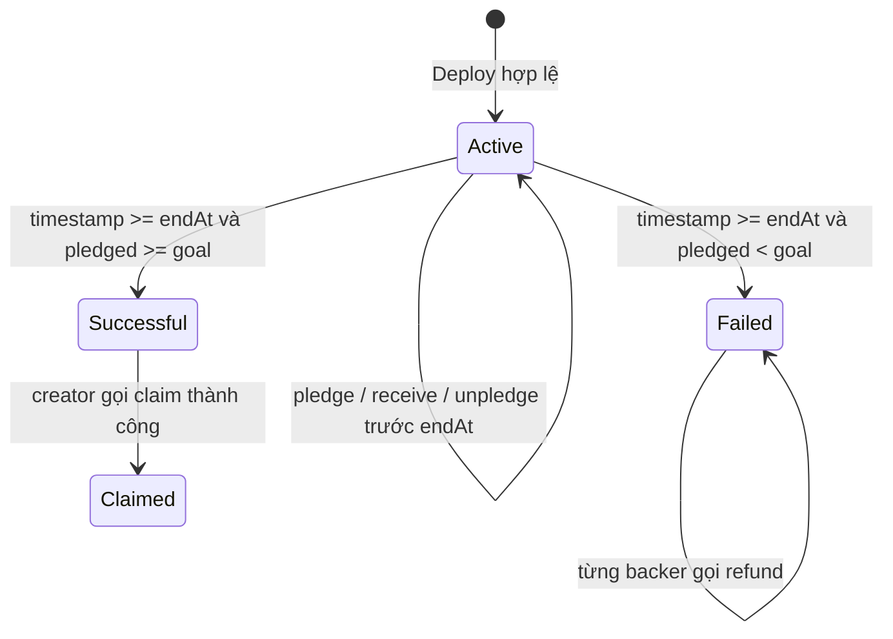

# PHẦN 3: PHÂN TÍCH, THIẾT KẾ VÀ TRIỂN KHAI THỰC NGHIỆM

---

## 3.1. Kiến trúc hệ thống và máy trạng thái

### 3.1.1. Máy trạng thái
Trạng thái trả về từ `state()` được tính từ `claimed`, `block.timestamp`, `endAt`, `pledged` và `goal`. Đủ vốn trước hạn vẫn là `Active`. Không có tác vụ tự động gửi tiền hoặc ghi trạng thái mới vào storage khi đồng hồ đến deadline.



Các mũi tên do deadline biểu diễn thay đổi **trạng thái được tính khi đọc**, không phải giao dịch tự thực thi. Claim/refund cần lời gọi và phí gas của người gửi giao dịch.

### 3.1.2. Điều kiện và phân quyền
| Trạng thái | Điều kiện đọc | pledge/receive | unpledge | claim | refund |
| :--- | :--- | :--- | :--- | :--- | :--- |
| `Active` | Chưa claimed, `timestamp < endAt` | Giá trị > 0 | Người gọi rút khoản của họ, amount hợp lệ | Creator vẫn bị chặn vì chưa hết hạn | Bị chặn vì chưa hết hạn |
| `Successful` | Chưa claimed, hết hạn và đủ goal | Bị chặn | Bị chặn | Chỉ creator | Bị chặn vì đủ goal |
| `Failed` | Chưa claimed, hết hạn và thiếu goal | Bị chặn | Bị chặn | Bị chặn vì thiếu goal | Người có khoản ghi nhận tự rút |
| `Claimed` | `claimed == true` | Bị chặn | Bị chặn | Creator không được claim lần hai | Bị chặn vì pledged vẫn >= goal |

`onlyCreator` chạy trước phần thân claim/sweep, nên ví không phải creator nhận `Unauthorized` ngay cả khi deadline hoặc mục tiêu cũng chưa thỏa. `sweepExcessEther()` không nằm trong luồng quyết toán thông thường: chỉ creator, balance phải lớn hơn pledged, không bắt buộc hết hạn.

---

## 3.2. Mã nguồn và triển khai Smart Contract

### 3.2.1. Cấu trúc thư mục
```text
contracts/
├── Crowdfunding.sol             # Contract chính
├── CrowdfundingFactory.sol      # Tạo/tra cứu các campaign độc lập
└── testing/Attackers.sol         # ReentrancyAttacker, ForceEther, RejectingReceiver
test/
├── Crowdfunding.test.js         # 18 test mô hình JavaScript
└── Crowdfunding.evm.test.js     # 41 test thực thi Solidity trên Hardhat EVM
demo/
├── index.html                   # Giao diện trình diễn desktop/projector
├── style.css                    # Theme sáng/tối
└── app.js                       # Sandbox và connector Web3
```

Helper trong `contracts/testing/` chỉ dành cho test. `RejectingReceiver` có điều khiển không phân quyền để kiểm thử, không dùng làm ví production.

### 3.2.2. Các hàm cốt lõi trong Crowdfunding.sol
Mã tham chiếu: [Crowdfunding.sol](../../contracts/Crowdfunding.sol).

#### 1. Hàm khởi tạo `constructor`
Kiểm tra goal khác 0 và duration trong khoảng 1 giây đến 365 ngày. Creator là địa chỉ truyền vào, hoặc `msg.sender` nếu truyền địa chỉ 0. Gán `goal`, `startAt`, `endAt`, khởi tạo guard và emit `Launch`. Timestamp dùng `uint64`; biến immutable không chiếm slot storage như biến trạng thái thông thường.

`state()` ưu tiên `claimed`; nếu chưa claim thì xét deadline trước rồi mới xét goal. `timeLeft()` trả về 0 tại/sau hạn; `progressBasisPoints()` biểu diễn tỷ lệ bằng basis points và có thể vượt 10.000 nếu vượt mục tiêu.

#### 2. Hàm góp vốn `pledge()` và `receive()`
Trước deadline và với `msg.value > 0`, tăng `pledged`, tăng `pledgedAmount[msg.sender]`; nếu khoản cũ bằng 0 thì tăng `contributorCount`. Emit `Pledge`.

`receive()` thực hiện cùng quy tắc ghi nhận cho chuyển ETH thông thường có calldata rỗng. Hai hàm không có external call nên không dùng guard. Không suy ra chúng ngăn được mọi đường chuyển ETH, hoặc việc bỏ guard đã có số gas tiết kiệm được đo cố định.

#### 3. Hàm rút trước hạn `unpledge(uint256)`
Yêu cầu `timestamp < endAt`, amount dương và không vượt khoản của người gọi. Trừ tổng và mapping trước khi chuyển ETH; rút hết thì giảm bộ đếm. Chuyển tiền lỗi gây `TransferFailed` và rollback cả phần trừ/bộ đếm. Test còn kiểm tra rút hết rồi góp lại và từ chối rút tại đúng `endAt`.

#### 4. Hàm giải ngân `claim()`
Chỉ creator, sau hạn, đủ goal và chưa claimed. Đặt `claimed = true`, lấy **toàn bộ balance thực tế**, emit `Claim`, chuyển ETH; nếu chuyển lỗi thì rollback cả cờ claimed. Do đó khoản gửi vượt goal hoặc forced ETH có mặt lúc claim được tính vào tiền chuyển.

Claim thành công không xóa `pledged`/mapping; đây là sổ sách giữ lại sau quyết toán, không phải tiền vẫn còn trong escrow. Ví thường không được claim; creator đủ vốn nhưng gọi tại `endAt - 1` vẫn bị `CampaignActive`.

#### 5. Hàm hoàn tiền `refund()`
Sau hạn và `pledged < goal`, người gọi có khoản ghi nhận dương được tự rút. Xóa khoản cá nhân, giảm pledged, emit `Refund`, sau đó chuyển ETH qua call. Guard chạy trước phần thân nên nested refund trả `ReentrancyGuardTriggered`; CEI là lớp bảo vệ sổ sách riêng. Đoạn code đầy đủ được trích ở mục 2.3.1.

Nếu chuyển ETH lỗi, sổ sách rollback. Một receiver từ chối ETH không làm giao dịch refund riêng của backer khác thất bại. Refund trả khoản góp còn ghi nhận, không hoàn phí gas của các giao dịch trước đó. `contributorCount` chỉ bị giảm ở nhánh unpledge toàn bộ, không giảm trong refund; không dùng nó để suy ra số người chưa nhận refund sau thất bại.

#### 6. Hàm quét phần dư `sweepExcessEther()`
Chỉ creator, có guard, yêu cầu `balance > pledged`; chuyển phần chênh dương và không giảm sổ sách góp. Không yêu cầu hết hạn. Chuyển lỗi gây revert; test kiểm tra phần góp vẫn còn nguyên khi sweep thất bại và sau khi thử lại thành công.

Sau [EIP-6780](https://eips.ethereum.org/EIPS/eip-6780), SELFDESTRUCT vẫn chuyển balance kể cả khi contract gửi đã tồn tại từ trước; điều kiện cùng transaction liên quan tới xóa code/storage. Vì vậy không dùng `balance == pledged` như bất biến mọi trạng thái. Sweep cũng không phải cơ chế lấy lại mọi khoản ETH bất kỳ gửi sau quyết toán; luôn xét điều kiện hiện tại của hàm.

### 3.2.3. CrowdfundingFactory.sol
[Factory](../../contracts/CrowdfundingFactory.sol) tạo campaign với **creator là người gọi factory**, không phải địa chỉ factory. Mỗi campaign có storage và số dư riêng. Factory giữ danh sách, tra cứu theo creator và phân trang `getCampaigns(offset, limit)` với `MAX_PAGE_SIZE = 100`.

Test hiện có kiểm tra tạo campaign/event, phân trang, offset ngoài biên và độc lập. Test yêu cầu limit 150 trên danh sách chỉ có 5 campaign chưa tự nó chứng minh trả tối đa 100 khi có hơn 100 campaign; không gọi đây là coverage đầy đủ cho mọi tình huống phân trang.

---

## 3.3. Kiểm thử hai tầng và minh chứng theo thành viên

**Kết quả lần chạy `npm test` ngày 2026-11-08: 18 test mô hình JavaScript + 41 test Hardhat EVM đạt, không có test thất bại.** Số lượng test không phải tỷ lệ statement/branch coverage.

* Tầng mô hình: `test/Crowdfunding.test.js` kiểm tra logic JavaScript, không biên dịch/thực thi Solidity.
* Tầng EVM: `test/Crowdfunding.evm.test.js` chạy bytecode trên Hardhat Network cục bộ, solc 0.8.20, optimizer 200 runs. Đây không phải bằng chứng đã ký/broadcast giao dịch lên Sepolia.
* Hardhat cũng nạp file test mô hình trong lúc discovery nên log 18 test có thể xuất hiện hai lần khi chạy `npm test`; không đếm thành 36 test mô hình.

| Nhóm EVM | Minh chứng chính | Giới hạn |
| :--- | :--- | :--- |
| Khởi tạo | Creator/goal/duration, input không hợp lệ | Các đầu vào đã chọn |
| Góp/rút | Đa backer, receive, số 0, rút một phần, rút hết/góp lại, quá khoản góp, tại/sau hạn | Không suy ra mọi chuỗi thao tác |
| Thành công | Đủ goal nhưng trước hạn; claim đúng endAt; sai quyền; claim hai lần; vượt goal | Không chứng minh khả năng đưa giao dịch vào block trước hạn |
| Thất bại/refund | Điều kiện thất bại, giảm sổ sách, hoàn hai lần, đủ goal đúng từng wei | Người gọi vẫn cần trả gas |
| An toàn | Nested refund; forced ETH; sweep; rollback/retry ở unpledge/claim/refund/sweep; backer khác vẫn refund được | Các receiver/callback đã mô hình hóa |
| Fuzz | 80 thao tác pledge/unpledge, 4 actor, seed `0xC0FFEE`; kiểm tra tổng mapping và balance | Chỉ còn hạn, không claim/refund/forced ETH; không phải bất biến toàn lifecycle |
| Factory | Deploy, tra cứu/phân trang, độc lập campaign | Chưa kiểm tra limit cap trên hơn 100 campaign |

### Ba test tiêu biểu mỗi thành viên
Chạy từ thư mục repository; regex dưới chọn test hiện có theo tên:

```bash
# TV1: rút một phần, rút hết/góp lại, chặn tại endAt — 3 test
npx hardhat test test/Crowdfunding.evm.test.js --grep "Unpledge một phần|TV1:"

# TV2: đủ vốn trước hạn, claim đúng endAt, sai quyền — 3 test
npx hardhat test test/Crowdfunding.evm.test.js --grep "TV2:|Người lạ claim|claim hợp lệ TẠI"

# TV3: rollback/cô lập lỗi, nested refund, forced ETH — 3 test
npx hardhat test test/Crowdfunding.evm.test.js --grep "refund lỗi rollback|ReentrancyAttacker:|Forced ETH qua"
```

| Người trình bày | Bảng trước → sau cần giải thích |
| :--- | :--- |
| TV1 | Góp 3, rút 1: khoản cá nhân 3 → 2, pledged giảm 1, bộ đếm giữ nguyên. Rút toàn bộ: khoản về 0 và bộ đếm giảm; góp lại tăng bộ đếm. |
| TV2 | Đủ goal tại endAt − 1: Active, claimed false, quỹ chưa chuyển. Tại endAt: creator claim được; sau claim claimed true, balance 0, sổ sách góp vẫn còn. |
| TV3 | Receiver từ chối refund: mapping/pledged/balance không mất; backer khác vẫn refund được. Khi receiver chấp nhận ETH, retry hoàn khoản hợp lệ. |

**Giới hạn kết luận:** các test xác nhận những kịch bản được thực thi, chưa có số liệu coverage để nói bao phủ 100% custom errors/branches. Chưa kiểm chứng mọi seed, mọi kiểu callback hay toàn bộ vòng đời trong fuzz. Không suy ra an toàn tuyệt đối.

### 3.3.1. Phân tích tĩnh Slither
Chạy lại Slither 0.11.6 với solc 0.8.20 trên từng contract production: Crowdfunding có 13 instance (7 Low + 6 Informational); factory kèm dependency có 16 (7 Low + 9 Informational). Không có High/Medium ở hai lượt. Bốn là số nhóm detector, không phải bốn phát hiện Informational. Lượt factory lặp lại kết quả của dependency nên không cộng hai tổng.

Xem [raw output, source hash, lệnh và triage](../security/slither-report.md). Kết quả không phải audit độc lập; helper kiểm thử không nằm trong hai lượt phân tích này.

---

## 3.4. Giao diện demo và thực nghiệm

### 3.4.1. Trình bày mục tiêu, thời hạn và điều kiện
Giao diện desktop/projector có theme sáng/tối, hiển thị số tiền/goal, tiến độ và số dư escrow. Ba điều kiện mục tiêu — thời hạn — quyền creator được đặt cạnh thao tác. Ledger/log giúp giải thích thay đổi sổ sách; phần chi tiết Solidity là thông tin bổ trợ.

Toolbar sandbox cho phép chọn kịch bản và mốc thời gian, gồm 6.9d và **7.0d đúng hạn**. Điều khiển này tác động JavaScript, không chỉnh timestamp trên Ethereum/Hardhat. Nút bị khóa minh họa quy tắc UI; test EVM mới là bằng chứng contract từ chối lời gọi trực tiếp không hợp lệ.

### 3.4.2. Kịch bản sandbox khớp mã hiện tại
1. **Góp/rút — TV1:** reset → Alice góp 3 ETH → rút 1 → khoản còn 2; thử rút quá khoản góp. Đây là tiền mô phỏng, không có gas thật.
2. **Đủ vốn nhưng chưa hết hạn — TV2:** nút kịch bản chuẩn bị Alice 4 + Bob 3 + Charlie 3 = **10/10 ETH ở ngày 6.9**. Creator vẫn chưa được claim. Chuyển **7.0d**; ví thường vẫn sai quyền, creator claim được. Sau claim, escrow 0 còn pledged/mapping giữ nguyên.
3. **Thất bại/hoàn tiền — TV3:** kịch bản chuẩn bị Alice góp **3/10 ETH, ngày 7.2**, chọn Alice. Refund đưa khoản cá nhân và tổng ghi nhận về 0; không hoàn lần hai. Số dư khôi phục trong sandbox không chứng minh ví thật được hoàn gas.
4. **Vượt mục tiêu — dự phòng:** kịch bản riêng góp **4 + 4 + 4 = 12/10 ETH**, ngày 7.2, chọn creator. Claim nhận 12 ETH mô phỏng. Không nhầm với test EVM oversubscription dùng 11 ETH.

### 3.4.3. Connector MetaMask
Người dùng nhập địa chỉ campaign, kết nối ví trên mạng hỗ trợ. DApp tạo provider/signer/contract instance, đọc state và cập nhật quyền thao tác. Đọc được `goal()` là kiểm tra cơ bản, không xác thực hoàn toàn code ở địa chỉ đích. Cần kiểm tra chain ID, địa chỉ deploy và code/ABI đúng phiên bản.

Mỗi giao dịch ghi hash, trạng thái chờ và receipt/block khi xác nhận; đọc RPC cập nhật state riêng, không thay thế lịch sử giao dịch. Lịch sử chỉ giữ các giao dịch gần nhất trong phiên. Đổi account cần gắn lại signer; lỗi RPC phải được phân biệt với giao dịch revert.

**Mức xác minh:** browser regression với provider/contract giả lập không phải ký/broadcast MetaMask thật. Chỉ ghi kết quả thực nghiệm Sepolia khi đã có chain ID, địa chỉ, hash và receipt. Nếu demo trực tiếp gặp lỗi mạng/ví, dùng test EVM cục bộ làm phương án dự phòng và nói rõ môi trường; không trình bày log sandbox như chứng cứ on-chain.
