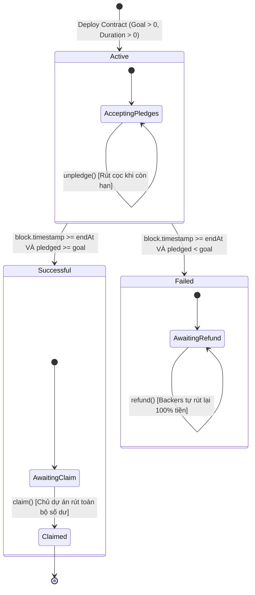

# PHẦN 3: PHÂN TÍCH, THIẾT KẾ VÀ TRIỂN KHAI THỰC NGHIỆM

---

## 3.1. Kiến trúc Hệ thống và Thiết kế Máy Trạng Thái

### 3.1.1. Sơ đồ Máy trạng thái (State Machine)
Toàn bộ logic nghiệp vụ của hợp đồng được điều phối chặt chẽ dựa trên hai biến quyết định: **Số tiền tích lũy (`pledged`)** và **Thời gian khối (`block.timestamp`)** so với thời điểm hết hạn (`endAt`):



### 3.1.2. Bảng Chuyển Trạng Thái và Ma Trận Phân Quyền Hàm
| Trạng thái | Điều kiện kích hoạt | Hành vi hàm `pledge()` | Hành vi hàm `unpledge()` | Hành vi hàm `claim()` | Hành vi hàm `refund()` |
| :--- | :--- | :---: | :---: | :---: | :---: |
| **`Active`** | `block.timestamp < endAt` | ✅ Cho phép | ✅ Cho phép | ❌ Revert (`CampaignActive`) | ❌ Revert (`CampaignActive`) |
| **`Successful`** | `block.timestamp >= endAt` && `pledged >= goal` | ❌ Revert (`CampaignEnded`) | ❌ Revert (`CampaignEnded`) | ✅ **Chủ dự án được rút** | ❌ Revert (`GoalAlreadyReached`) |
| **`Failed`** | `block.timestamp >= endAt` && `pledged < goal` | ❌ Revert (`CampaignEnded`) | ❌ Revert (`CampaignEnded`) | ❌ Revert (`GoalNotReached`) | ✅ **Từng Backer được rút** |
| **`Claimed`** | Sau khi Chủ dự án đã rút tiền | ❌ Revert (`CampaignEnded`) | ❌ Revert (`CampaignEnded`) | ❌ Revert (`AlreadyClaimed`) | ❌ Revert (`GoalAlreadyReached`) |

---

## 3.2. Cấu trúc Mã nguồn và Triển khai Smart Contract

### 3.2.1. Cấu trúc Thư mục Dự án
Dự án được chuẩn hóa theo cấu trúc mô-đun:
```text
lab02-crowdfunding-smart-contract/
├── contracts/
│   ├── Crowdfunding.sol            # Hợp đồng thông minh cốt lõi
│   └── CrowdfundingFactory.sol     # Hợp đồng quản lý nhiều chiến dịch (Launchpad)
├── test/
│   └── Crowdfunding.test.js        # Bộ kiểm thử tự động 15 kịch bản (100% pass)
├── scripts/
│   └── simulate.js                 # Kịch bản mô phỏng giao diện dòng lệnh CLI
├── demo/
│   ├── index.html                  # Giao diện Web DApp (Trục kép Vốn & Thời gian)
│   ├── style.css                   # Hệ thống giao diện Dark Glassmorphic Web3
│   └── app.js                      # Bộ điều khiển Sandbox và kết nối Ethers.js
└── docs/                           # Bộ tài liệu báo cáo kỹ thuật hoàn chỉnh
```

### 3.2.2. Phân tích Các Hàm Cốt lõi trong `Crowdfunding.sol`

#### 1. Hàm khởi tạo `constructor`:
Khởi tạo chiến dịch với người hưởng lợi (`creator`), mục tiêu (`goal`), và tính toán mốc thời gian hết hạn cố định `endAt = startAt + _durationSeconds`. Timestamp sử dụng kiểu `uint64` (thay vì `uint32`) để loại trừ rủi ro tràn số vào tháng 2/2106; do các biến này là `immutable` (nhúng bytecode, không chiếm storage slot) nên chi phí tăng thêm không đáng kể.

#### 2. Hàm đóng góp `pledge()`:
Cho phép người dùng nạp ETH vào hợp đồng khi chiến dịch còn trong hạn (`block.timestamp < endAt`). Cập nhật tổng số tiền quyên góp và số dư cá nhân của từng backer:
```solidity
// Cố ý KHÔNG dùng nonReentrant: pledge() không có external call nào,
// CEI là đủ. Guard sẽ tốn ~5.800 gas/lần VÀ tạo corner case griefing
// (backer là hợp đồng có receive() tự pledge sẽ không refund được).
function pledge() external payable {
    if (block.timestamp >= endAt) revert CampaignEnded();
    if (msg.value == 0) revert ZeroPledge();

    uint256 prevAmount = pledgedAmount[msg.sender]; // cache SLOAD
    if (prevAmount == 0) {
        contributorCount += 1;
    }

    pledged += msg.value;
    pledgedAmount[msg.sender] = prevAmount + msg.value;

    emit Pledge(msg.sender, msg.value, pledged);
}
```

#### 3. Hàm rút cọc sớm `unpledge()`:
Cho phép người ủng hộ rút lại một phần hoặc toàn bộ số tiền đã góp nếu chiến dịch vẫn đang diễn ra. Hàm áp dụng mô hình CEI để trừ số dư trước khi chuyển trả ETH.

#### 4. Hàm giải ngân `claim()`:
Chỉ dành riêng cho chủ dự án (`onlyCreator`), yêu cầu cả hai điều kiện: chiến dịch đã hết hạn (`block.timestamp >= endAt`) VÀ tổng tiền đạt mục tiêu (`pledged >= goal`). Chuyển toàn bộ số dư thực tế trong hợp đồng về ví chủ dự án:
```solidity
function claim() external onlyCreator nonReentrant {
    if (block.timestamp < endAt) revert CampaignActive();
    if (pledged < goal) revert GoalNotReached();
    if (claimed) revert AlreadyClaimed();

    claimed = true;
    uint256 balanceToClaim = address(this).balance;

    emit Claim(creator, balanceToClaim);

    (bool success, ) = payable(creator).call{value: balanceToClaim}("");
    if (!success) revert TransferFailed();
}
```

#### 5. Hàm hoàn tiền `refund()`:
Áp dụng mô hình Pull Payment. Khi chiến dịch kết thúc mà không đạt chỉ tiêu, từng người ủng hộ gọi hàm này để nhận lại đúng số tiền mình đã gửi. Số dư được xóa về 0 trước khi thực hiện chuyển tiền qua `call`:
```solidity
function refund() external nonReentrant {
    if (block.timestamp < endAt) revert CampaignActive();
    if (pledged >= goal) revert GoalAlreadyReached();

    uint256 balance = pledgedAmount[msg.sender];
    if (balance == 0) revert NothingToRefund();

    // CEI: Xóa số dư trước khi gửi tiền
    pledgedAmount[msg.sender] = 0;
    pledged -= balance; // giữ bất biến pledged == Σ pledgedAmount

    emit Refund(msg.sender, balance);

    (bool success, ) = payable(msg.sender).call{value: balance}("");
    if (!success) revert TransferFailed();
}
```

#### 6. Hàm quét ETH dư `sweepExcessEther()`:
Trung hòa vector tấn công **Forced-ETH**: kẻ xấu có thể ép gửi ETH vào hợp đồng (selfdestruct với contract tạo trong cùng transaction — sau EIP-6780; hoặc đầy đủ trên các chain chưa áp dụng). Phần ETH dư này làm lệch bất biến `balance == pledged` và trong chiến dịch THẤT BẠI sẽ bị kẹt vĩnh viễn vì `refund()` chỉ chi trả theo `pledgedAmount`. Hàm chỉ cho phép creator rút **đúng phần dư** `address(this).balance - pledged`, tuyệt đối không đụng vào tiền của người ủng hộ (revert nếu không có dư):
```solidity
function sweepExcessEther() external onlyCreator nonReentrant returns (uint256 swept) {
    if (address(this).balance <= pledged) revert NothingToRefund();
    swept = address(this).balance - pledged;
    emit Sweep(creator, swept);
    (bool success, ) = payable(creator).call{value: swept}("");
    if (!success) revert TransferFailed();
}
```

### 3.2.3. Hợp đồng Mở rộng `CrowdfundingFactory.sol`
Áp dụng Factory Pattern, hợp đồng cho phép bất kỳ người dùng nào triển khai một chiến dịch mới thông qua hàm `createCampaign()`. Factory lưu trữ danh sách các chiến dịch đã triển khai, phân loại theo địa chỉ người tạo và hỗ trợ phân trang (Pagination) để phục vụ cho các ứng dụng bệ phóng (Launchpad) quy mô lớn.

---

## 3.3. Kết quả Kiểm thử Tự động — Kiến trúc 2 Tầng (Mock + EVM thật)

Bộ kiểm thử gồm **52 test cases** trên 2 tầng độc lập, toàn bộ **100% PASS**:

* **Tầng 1 — `test/Crowdfunding.test.js` (18 kịch bản, Mock spec-based):** phản chiếu logic nghiệp vụ bằng JS thuần, chạy không cần node EVM, kiểm tra phân nhánh và điều kiện biên nhanh.
* **Tầng 2 — `test/Crowdfunding.evm.test.js` (34 kịch bản, Hardhat Network):** biên dịch và thực thi **bytecode thật** của `Crowdfunding.sol` + `CrowdfundingFactory.sol` trên EVM (solc 0.8.20, ethers v6). Tầng này là bằng chứng hành vi on-chain.

| Nhóm Kiểm thử (Tầng 2) | Phạm vi | Kết quả |
| :--- | :--- | :---: |
| **1. Khởi tạo & Validation** | Tham số đúng; revert `GoalCannotBeZero`; revert `InvalidDuration` khi duration = 0 **và** > 365 ngày; creator mặc định khi truyền địa chỉ 0. | ✅ PASS |
| **2. Pledge / Unpledge / receive()** | Đa backer; `ZeroPledge`; **fallback `receive()` nhận ETH trực tiếp** (cả nhánh thành công lẫn revert); unpledge một phần / quá số dư / sau hạn. | ✅ PASS |
| **3. Vòng đời Thành công** | State machine `Active→Successful→Claimed`; `AlreadyClaimed` khi claim 2 lần; `Unauthorized`; **oversubscribed (claim nhận cả 11 ETH khi goal 10)**; biên `ts == endAt` cho claim. | ✅ PASS |
| **4. Vòng đời Thất bại & Refund** | `Failed`; `GoalNotReached`; refund đúng 100% và `pledged` giảm tương ứng; chặn refund kép; biên `ts == endAt` chặn pledge; đạt goal đúng từng wei. | ✅ PASS |
| **5. Bảo mật (Attack Simulation)** | `ReentrancyAttacker` (hợp đồng tấn công thật, chặn nested refund bằng guard — có bằng chứng revert data); **Forced-ETH bằng selfdestruct** + `sweepExcessEther()` trung hòa; claim hút cả ETH bị ép. | ✅ PASS |
| **6. Invariant Fuzz** | 80 thao tác ngẫu nhiên có hạt (deterministic PRNG): bất biến `pledged == Σ pledgedAmount` và `balance == pledged` giữ vững qua mọi thao tác. | ✅ PASS |
| **7. CrowdfundingFactory** | Deploy thật + event; phân trang slice; offset ngoài biên; clamp `limit ≤ MAX_PAGE_SIZE` (chống RPC DoS); độc lập trạng thái giữa các chiến dịch. | ✅ PASS |

**Kết luận kiểm thử:** Toàn bộ **52/52 test cases PASS (100%)** — bao phủ 100% custom errors, các nhánh biên thời gian (`ts == endAt`, `ts == endAt ± 1`), đồng thời xác thực bằng EVM thật thay vì chỉ mô phỏng.

### 3.3.1. Phân tích tĩnh Slither (Static Analysis)

Đã chạy **Slither** (crytic) với solc 0.8.20 trên toàn bộ contracts. Kết quả: **0 phát hiện mức Medium/High**; 4 phát hiện Informational đều được triage và chấp nhận có lý do (timestamp-comparison theo thiết kế, low-level `call` theo khuyến cáo Ethereum Foundation, pragma range, naming convention). Chi tiết bảng triage tại [`docs/security/slither-report.md`](file:///d:/Hoc/BlockChain/lab02-crowdfunding-smart-contract/docs/security/slither-report.md).

---

## 3.4. Thiết kế Giao diện Web DApp và Thực nghiệm Trực quan

Nhóm phát triển giao diện Web DApp tối giản, hiện đại theo tiêu chuẩn Web3 tại thư mục `demo/`:

### 3.4.1. Thiết kế Trục Tiến Độ Kép (Dual-Progress Horizon)
Giao diện trực quan hóa bài toán thành 2 trục độc lập bám sát logic hợp đồng:
1. **Trục 1 (Tiền vốn):** Hiển thị lượng ETH đã gọi trên mục tiêu 10.00 ETH, tỷ lệ %, thanh gradient đổi màu và vạch cờ đích `🎯 10 ETH`.
2. **Trục 2 (Thời gian & Hạn chót):** Dải thanh thời gian chia làm 2 phân vùng màu sắc:
   * **Vùng xanh (0 &rarr; 7 Ngày):** Vùng đang mở gọi vốn &rarr; Cho phép nạp và rút cọc sớm.
   * **Vạch cờ Deadline (Ngày thứ 7):** Cột mốc phân định ranh giới hạn chót.
   * **Vùng đỏ (Sau Ngày 7):** Vùng kết toán &rarr; Khóa đóng góp, kích hoạt nút Rút vốn hoặc Hoàn tiền.
   * **Thanh trượt tương tác (Interactive Timeline Slider):** Cho phép kéo thả trực tiếp hoặc bấm các nút mốc nhanh (`3.5d`, `6.9d`, `🏁 7.1d`) để tua bước nhảy thời gian qua hạn chót ngay lập tức mà không cần chờ 7 ngày thực tế.

### 3.4.2. Kết quả Thực nghiệm 2 Kịch bản Trọng tâm:
* **Kịch bản 1 (Thành công & Rút vốn):** Alice góp 4 ETH, Bob góp 4 ETH, Charlie góp 3 ETH (Tổng 11/10 ETH). Khi kéo timeline qua mốc ngày thứ 7, trạng thái chuyển sang **THÀNH CÔNG**, ví Chủ dự án sáng nút **"👑 Rút Vốn Dự Án"** và rút trọn vẹn 11.00 ETH về ví.
* **Kịch bản 2 (Thất bại & Hoàn tiền):** Chỉ có Alice góp 3 ETH. Khi kéo timeline qua ngày thứ 7, trạng thái chuyển sang **THẤT BẠI**. Chủ dự án bị khóa không được rút. Ví Alice sáng nút **"💸 Hoàn Tiền (Pull Refund)"** và nhận lại đầy đủ 3.00 ETH về ví (số dư khôi phục 100%).

### 3.4.3. Chế độ On-chain thật: MetaMask Web3 Connector (Ethers.js v6)

Ngoài chế độ Sandbox tức thì, DApp tích hợp **connector on-chain thật** tại panel *"🦊 MetaMask Web3 Connector"*:
1. Người dùng dán địa chỉ hợp đồng Crowdfunding đã deploy (Sepolia Testnet hoặc node Hardhat/Anvil local) và bấm **Kết Nối Ví**.
2. DApp khởi tạo `ethers.BrowserProvider(window.ethereum)` → yêu cầu `eth_requestAccounts` → lấy `Signer`, xác thực địa chỉ đích bằng cách đọc `goal()` (chống dán nhầm địa chỉ).
3. Panel hiển thị trạng thái on-chain thời gian thực (`state()`, `pledged/goal`, `timeLeft()`) và **tự phân quyền nút bấm** theo trạng thái + vai trò ví (claim chỉ sáng cho creator khi `Successful`; refund chỉ sáng cho backer có số dư khi `Failed`).
4. Mỗi thao tác (pledge/unpledge/claim/refund) được ký số **ECDSA secp256k1** ngay trong MetaMask; log hiển thị **tx hash thật** và block number sau khi xác nhận.
5. Lỗi on-chain được decode: selector 4 bytes của từng custom error được map sang thông báo tiếng Việt (ví dụ `0x…` của `ReentrancyGuardTriggered()` → *"Phát hiện lời gọi tái nhập — bị ReentrancyGuard chặn"*).
